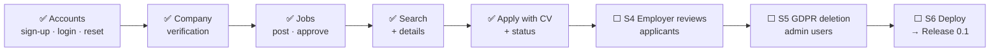
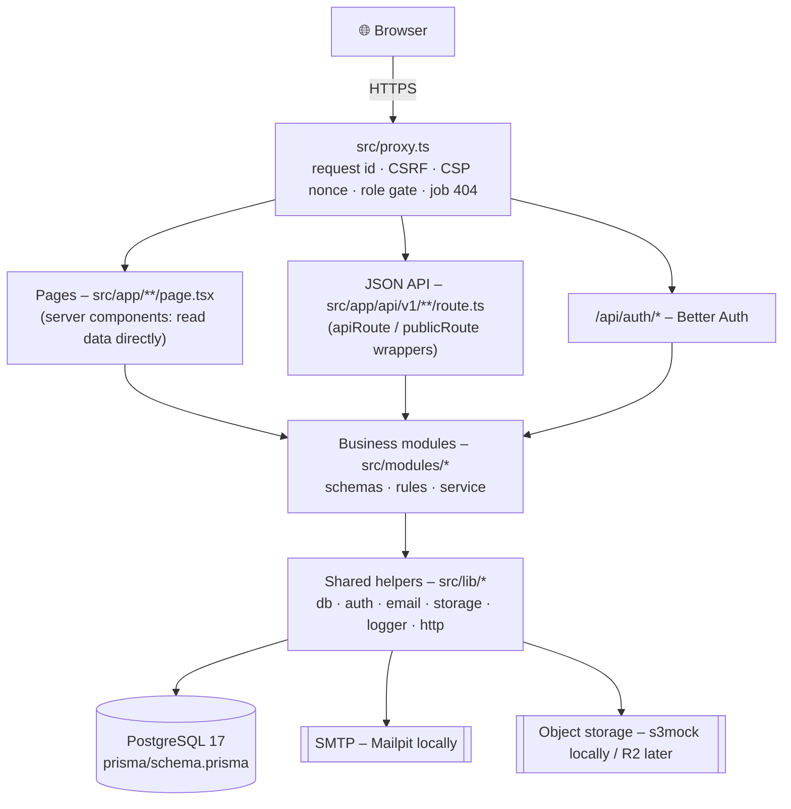
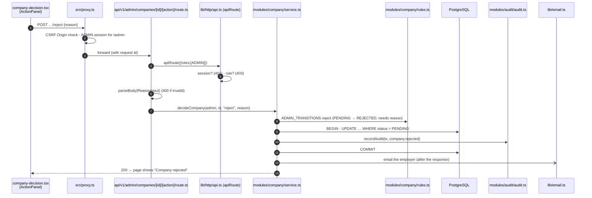
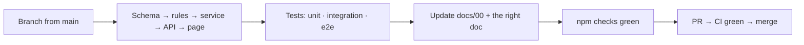

# JobConnect – Project Guide

> **One document to understand the whole project:** what it is, how it works, what every folder and file
> does, how to run and change it, and everything done so far.
> Written for someone new to the code. Last updated: 2026-11-12 (after sprint S3 + demo data).

---

## Contents
1. [What JobConnect is](#1-what-jobconnect-is)
2. [Where the project stands](#2-where-the-project-stands)
3. [The big picture in one diagram](#3-the-big-picture-in-one-diagram)
4. [Run it in 5 minutes](#4-run-it-in-5-minutes)
5. [Repository map – top level](#5-repository-map--top-level)
6. [`src/` – the application, file by file](#6-src--the-application-file-by-file)
7. [`prisma/` – database schema, migrations, seed data](#7-prisma--database-schema-migrations-seed-data)
8. [`e2e/`, `scripts/`, `.github/` – tests and automation](#8-e2e-scripts-github--tests-and-automation)
9. [`docs/` – every document](#9-docs--every-document)
10. [How a request travels through the files](#10-how-a-request-travels-through-the-files)
11. [The ideas that hold it together](#11-the-ideas-that-hold-it-together)
12. [How to make a change](#12-how-to-make-a-change)
13. [Everything done so far](#13-everything-done-so-far)
14. [What comes next](#14-what-comes-next)
15. ["Where do I find…?"](#15-where-do-i-find)

---

## 1. What JobConnect is

A **job marketplace** where **only verified employers can publish jobs** and **every application shows its
real status** from submission to decision.

| Role | What they do | Persona |
|---|---|---|
| **Candidate** | Searches jobs, keeps a profile and CVs, applies, follows each application's status | Amira |
| **Employer** | Creates a company profile (verified by an admin), posts jobs (approved by an admin), will manage applicants | David |
| **Administrator** | Verifies companies, approves/rejects/removes jobs, keeps scams out; every action is audited | Sophie |

It is a **portfolio project built to production standard** for the UK/EU (GDPR), by one part-time developer
working with an AI pair programmer (Claude Code), using Scrum + XP
([docs/07-implementation/01-agile-methodology.md](docs/07-implementation/01-agile-methodology.md)).

---

## 2. Where the project stands



| | |
|---|---|
| Phase | 3 – Build (MVP = Release 0.1) |
| Core loop | Steps 1–3 of 5 done |
| Tests | 118 unit · 83 integration · 40 end-to-end – all green |
| Deployed | Not yet (local only) |
| Live status | [docs/00-solution-document.md §1](docs/00-solution-document.md#1-status-at-a-glance) |
| See it working | [62-screenshot walkthrough](docs/04-design/07-system-walkthrough.md) |

---

## 3. The big picture in one diagram



**The one rule to remember:** pages and API routes are thin → **all business rules live in
`src/modules/*/service.ts`** → which use `src/lib/*` to talk to the database, email and file storage.

---

## 4. Run it in 5 minutes

Requires **Node 22** and **Docker**.

```bash
npm install                      # installs + generates the Prisma client
cp .env.example .env.local       # then set BETTER_AUTH_SECRET (openssl rand -base64 32)
npm run db:up                    # Docker: PostgreSQL + Mailpit (emails) + s3mock (files)
npm run db:deploy                # create the tables
npm run db:seed                  # 3 demo users (candidate, employer, admin)
npm run db:seed:demo             # optional: 100 companies, 152 users, ~210 jobs
npm run dev                      # http://localhost:3000
```

| Open | What |
|---|---|
| http://localhost:3000 | The app |
| http://localhost:8025 | Mailpit – every email the app sends |
| http://localhost:3000/api/health | Health check |

**Log in as:** `candidate@`, `employer@`, `admin@demo.jobconnect.local` – or `employer001…100`,
`candidate001…050`, `admin001…002@demo-data.jobconnect.local`. Password: `DEMO_PASSWORD` in
[`prisma/demo-users.ts`](prisma/demo-users.ts).

All commands: [README.md → Scripts](README.md#scripts).

---

## 5. Repository map – top level

```
jobconnect/
├── src/                 the application (pages, API, business logic)     → §6
├── prisma/              database schema, migrations, seed scripts         → §7
├── e2e/                 browser tests (Playwright)                         → §8
├── scripts/             performance test, test-catalogue generator         → §8
├── docs/                all documentation (12 folders)                     → §9
├── .github/             CI pipeline, Dependabot, PR template               → §8
└── (config files)       explained below
```

| File | What it is for |
|---|---|
| `README.md` | Short intro, setup, every `npm` script |
| `PROJECT_GUIDE.md` | **This guide** |
| `CLAUDE.md` | Rules for the AI assistant: keep docs in sync, never edit migrations, run checks before committing |
| `AGENTS.md` | Note from Next.js: read the bundled docs for this version (imported by `CLAUDE.md`) |
| `package.json` | Dependencies (pinned) and scripts (`dev`, `test`, `db:*`, `perf:search`, `docs:test-cases`…) |
| `package-lock.json` | Exact versions of every dependency – CI installs from this |
| `tsconfig.json` | TypeScript **strict** settings + `@/` import alias for `src/` |
| `next.config.ts` | Next.js settings: Cache Components on, security headers, Turbopack root, Tailwind loader |
| `eslint.config.mjs` | Lint rules (Next.js + TypeScript + Prettier compatibility), ignored folders |
| `.prettierrc.json`, `.prettierignore` | Code formatting (docs and generated files excluded) |
| `vitest.config.ts` | Unit tests (`*.test.ts`) |
| `vitest.integration.config.ts` | Integration tests (`*.int.test.ts`) against the real database, one file at a time |
| `playwright.config.ts` | Browser tests: builds the app, runs it on port 3100, Chromium |
| `prisma.config.ts` | Where Prisma finds the schema, migrations and `DATABASE_URL` |
| `docker-compose.yml` | Local services: `postgres:17-alpine`, `axllent/mailpit:v1.32.0`, `adobe/s3mock:5.2.3` |
| `.env.example` | Every environment variable, documented (copy to `.env.local`; never commit secrets) |
| `.nvmrc` | Node version (22) |
| `.gitignore` | Keeps secrets, `node_modules`, builds, test output and the generated Prisma client out of Git |

---

## 6. `src/` – the application, file by file

### 6.1 Entry points

| File | Role |
|---|---|
| `src/proxy.ts` | Runs **before every request**: gives it an id, blocks cross-site POSTs (CSRF), sets a per-request CSP nonce, sends logged-out users from `/employer`, `/admin`, `/candidate` to login and wrong roles to a real 404, returns a real 404 for hidden public jobs |
| `src/app/layout.tsx` | The HTML shell for every page: header, page content, phone tab bar; renders per request (needed for the CSP nonce) |
| `src/app/globals.css` | Tailwind CSS import and base styles |
| `src/app/favicon.ico` | Browser tab icon |

### 6.2 Pages (`src/app/**/page.tsx`) – what users see

| Route | File | Who | Purpose |
|---|---|---|---|
| `/` | `app/page.tsx` | Visitor | Home + search box; logged-in users go to their role's home |
| `/register` | `app/(auth)/register/page.tsx` | Visitor | Create account (role, name, email, password, privacy consent) |
| `/check-email` | `app/(auth)/check-email/page.tsx` | Visitor | "We've sent a link" |
| `/login` | `app/(auth)/login/page.tsx` | Visitor | Log in; honours `?next=` (back to where you were) |
| `/forgot-password` | `app/(auth)/forgot-password/page.tsx` | Visitor | Ask for a reset link |
| `/reset-password` | `app/(auth)/reset-password/page.tsx` | Visitor | Choose a new password |
| `/privacy` | `app/privacy/page.tsx` | All | Privacy policy (**placeholder** – must be written before launch) |
| `/jobs` | `app/jobs/page.tsx` | All | Public search: keyword, location, work mode, job type, "Load more" |
| `/jobs/[id]` | `app/jobs/[id]/page.tsx` | All | Job details; apply panel for candidates |
| `/candidate/profile` | `app/candidate/profile/page.tsx` | Candidate | Profile + CVs |
| `/candidate/applications` | `app/candidate/applications/page.tsx` | Candidate | My applications with status |
| `/candidate/applications/[id]` | `app/candidate/applications/[id]/page.tsx` | Candidate | One application + timeline |
| `/employer` | `app/employer/page.tsx` | Employer | Dashboard: company status, reason, next step |
| `/employer/company` | `app/employer/company/page.tsx` | Employer | Create / edit company profile |
| `/employer/jobs` | `app/employer/jobs/page.tsx` | Employer | Job list with status and application counts |
| `/employer/jobs/new` | `app/employer/jobs/new/page.tsx` | Employer | Write a job (saved as draft) |
| `/employer/jobs/[id]` | `app/employer/jobs/[id]/page.tsx` | Employer | Job preview, status, reason, actions (submit/pause/resume/close) |
| `/employer/jobs/[id]/edit` | `app/employer/jobs/[id]/edit/page.tsx` | Employer | Edit (explains when re-approval is needed) |
| `/admin` | `app/admin/page.tsx` | Admin | Queue counts |
| `/admin/companies` | `app/admin/companies/page.tsx` | Admin | Company verification queue (oldest first, tabs per status) |
| `/admin/companies/[id]` | `app/admin/companies/[id]/page.tsx` | Admin | Review a company; verify / reject / suspend / reinstate |
| `/admin/jobs` | `app/admin/jobs/page.tsx` | Admin | Job approval queue |
| `/admin/jobs/[id]` | `app/admin/jobs/[id]/page.tsx` | Admin | Job "as candidates will see it"; approve / reject / remove |

`(auth)` in a folder name groups routes without adding to the URL. `[id]` is a URL parameter.

### 6.3 API routes (`src/app/api/**/route.ts`) – JSON for the browser and tests

| Endpoint | File | Who |
|---|---|---|
| `/api/auth/*` (sign-up, sign-in, sign-out, verify, reset…) | `api/auth/[...all]/route.ts` | Better Auth |
| `GET /api/health` | `api/health/route.ts` | Anyone – 200 ok / 503 error (DB check) |
| `GET /api/v1/industries` | `api/v1/industries/route.ts` | Anyone |
| `GET /api/v1/jobs`, `GET /api/v1/jobs/{id}` | `api/v1/jobs/route.ts`, `[id]/route.ts` | Anyone (public search) |
| `GET·PUT /api/v1/candidate/profile` | `api/v1/candidate/profile/route.ts` | Candidate |
| `GET·POST /api/v1/candidate/cvs`, `DELETE …/{id}`, `GET …/{id}/download-url` | `api/v1/candidate/cvs/**` | Candidate |
| `GET·POST /api/v1/candidate/applications`, `GET …/{id}` | `api/v1/candidate/applications/**` | Candidate |
| `GET·POST·PATCH /api/v1/employer/company` | `api/v1/employer/company/route.ts` | Employer |
| `GET·POST /api/v1/employer/jobs`, `GET·PATCH …/{id}`, `POST …/{id}/{submit,pause,resume,close}` | `api/v1/employer/jobs/**` | Employer |
| `GET /api/v1/admin/companies`, `GET …/{id}`, `POST …/{id}/{verify,reject,suspend,reinstate}` | `api/v1/admin/companies/**` | Admin |
| `GET /api/v1/admin/jobs`, `GET …/{id}`, `POST …/{id}/{approve,reject,remove}` | `api/v1/admin/jobs/**` | Admin |

Full design: [docs/05-design/02-api-design.md](docs/05-design/02-api-design.md).

### 6.4 Business modules (`src/modules/`) – where the rules live

Each module follows the same pattern:

| File type | Contains | Runs in |
|---|---|---|
| `schemas.ts` | Zod input rules (shared by the form and the API) + display labels | Browser + server |
| `rules.ts` | Status transition tables and pure rule functions | Browser + server |
| `service.ts` | Use cases: role + ownership checks, guarded updates, audit, emails | Server only |
| `labels.ts` | Plain-language status labels and formatting | Both |
| `emails.ts` | Email templates (text + escaped HTML) | Server |
| `components/` | The module's forms and panels | Browser / server |
| `*.test.ts` / `*.int.test.ts` | Unit / integration tests | – |

**`modules/auth/`** – accounts
| File | Role |
|---|---|
| `signup-rules.ts` | No admin self-sign-up; current privacy-policy version must be accepted |
| `password.ts` | Argon2id hashing and verification |
| `emails.ts` | Verification, reset, "someone used your email" emails; HTML escaping |
| `messages.ts` | Auth error codes → plain-language messages |
| `session.ts` | `getCurrentUser()` and `requireUser(roles)` for pages |
| `policy.ts` | `requireRole()` – used at the start of every service function |
| `safe-next.ts` | Validates `?next=` so login can't redirect to another site |
| `components/` | Register, login, forgot/reset password forms, log-out button |

**`modules/company/`** – company profiles and verification
| File | Role |
|---|---|
| `schemas.ts` | Company fields, sizes, reason input |
| `rules.ts` | Verify / reject / suspend / reinstate transitions; editing rules |
| `service.ts` | Create/edit own company; admin queue, counts, decisions (transaction + audit + email) |
| `labels.ts`, `emails.ts` | Status words; decision emails |
| `components/company-form.tsx`, `company-decision.tsx` | Employer form; admin decision panel |

**`modules/job/`** – jobs and public search
| File | Role |
|---|---|
| `schemas.ts` | Job fields + cross-field rules (location unless remote, max ≥ min salary) |
| `rules.ts` | Deadlines (1–90 days), employer + admin transitions, "material edit" rule |
| `service.ts` | Employer job CRUD + actions; admin queue + decisions |
| `search.ts` | **`VISIBLE_JOB`** (the one public-visibility rule), full-text search, `isJobVisible`, public field allow-list |
| `search-params.ts` | Parsing search filters, cursor pagination, escaping `%`/`_` |
| `labels.ts`, `emails.ts` | Status words, salary/date formatting; decision emails |
| `components/` | Job form, preview, card, search form, employer/admin action buttons |

**`modules/candidate/`** – profile and CVs
| File | Role |
|---|---|
| `schemas.ts` | Profile fields |
| `cv-file.ts` | Detects PDF/DOCX **from the bytes**, size limit, cleans filenames |
| `service.ts` | Profile; upload (max 5, under a row lock), delete, 5-minute download links |
| `components/profile-form.tsx`, `cv-manager.tsx` | Profile form; CV list/upload/download/delete |

**`modules/application/`** – applying
| File | Role |
|---|---|
| `schemas.ts` | `jobId`, `cvId`, optional cover letter |
| `service.ts` | Apply (visible job, before deadline, own CV, once ever, CV snapshot, history); my applications |
| `labels.ts` | Candidate vs. employer status words ("Not selected" for candidates) |
| `components/candidate-apply.tsx`, `apply-form.tsx` | Apply panel on the job page; the 2-click apply form |

**`modules/audit/`** – `audit.ts`: `recordAudit()` writes append-only audit entries (refuses personal data).

`modules/schemas-roundtrip.test.ts` – guarantees every form schema accepts its own output (a past bug).

### 6.5 Shared helpers (`src/lib/`)

| File | Role |
|---|---|
| `db.ts` | The Prisma database client (created on first use) |
| `auth.ts` | **All authentication policy** (Better Auth config): Argon2id, 12+ chars, breach check, email verification, rate limits, audit hooks, suspended users blocked |
| `auth-client.ts` | Browser-side auth calls (sign-in, sign-up…) |
| `env.ts` | Validates environment variables at first use (names only in errors) |
| `email.ts` | Sends email over SMTP; `sendEmailInBackground` for notifications |
| `storage.ts` | Private file storage: upload, copy (snapshots), delete, 5-minute signed links |
| `logger.ts` | JSON logs with request id; hides personal data |
| `privacy.ts` | The list of sensitive field names (used by logs and audit) |
| `uuidv7.ts` | Time-ordered, unguessable ids for every row |
| `health.ts` | Health check logic (2-second DB ping) |
| `http/api.ts` | `apiRoute` (login + role) and `publicRoute` wrappers; `parseBody`; `json()` |
| `http/errors.ts` | `DomainError` + helpers (not found, forbidden, invalid transition, state changed) |
| `http/problem.ts` | Standard JSON error format (RFC 9457) and all error codes |
| `http/request-id.ts` | Request-id header helpers |
| `http/page.ts` | `orNotFound()` – service "not found" → 404 page |
| `security/csp.ts` | Builds the Content Security Policy and nonces |
| `security/csrf.ts` | The Origin check |
| `client/api.ts` | Browser helper to call the API and read errors |

### 6.6 Shared UI (`src/components/`)

| File | Role |
|---|---|
| `site-header.tsx` | Top bar: logo, role navigation (a link row on phones for employers/admins), name, log out |
| `candidate-tab-bar.tsx`, `mobile-nav.tsx` | Candidate bottom tab bar on phones (Find jobs · Applied · Me) |
| `action-panel.tsx` | Choose an action → confirm (consequence stated) → optional reason → done |
| `auth-card.tsx` | Centred card used by auth pages |
| `ui/button.tsx`, `ui/text-field.tsx`, `ui/select-field.tsx`, `ui/textarea-field.tsx`, `ui/alert.tsx`, `ui/status-badge.tsx` | Accessible building blocks (labels, error linking, live regions) |

`src/generated/prisma/` (not in Git) is created by `prisma generate` – never edit it.

---

## 7. `prisma/` – database schema, migrations, seed data

| File | Role |
|---|---|
| `schema.prisma` | **The data model**: every table, column, enum and relation |
| `migrations/*/migration.sql` | The exact SQL that built the database, in order (**never edit an existing one**) |
| `migrations/migration_lock.toml` | Records that the database is PostgreSQL |
| `seed.ts` + `demo-users.ts` | `npm run db:seed` – 3 demo users; the shared demo password |
| `seed-demo-data.ts` | `npm run db:seed:demo` – 100 companies, 152 users, ~210 jobs (local only) |

| Migration | Created |
|---|---|
| `…_init` | `citext` (case-insensitive emails), UTC timezone |
| `…_audit_log` | Append-only audit table with protective triggers |
| `…_auth` | `user`, `session`, `account`, `verification`, `rate_limit` |
| `…_companies` | `industry` (13 seeded), `company` |
| `…_jobs` | `job` + its rules and indexes |
| `…_job_search`, `…_job_search_vector` | Full-text search (stored `search_vector` + GIN index) |
| `…_candidates_and_applications` | `candidate_profile`, `cv`, `application`, `application_status_history` |

ER diagram: [docs/05-design/05-er-diagram.md](docs/05-design/05-er-diagram.md).

---

## 8. `e2e/`, `scripts/`, `.github/` – tests and automation

| File | Role |
|---|---|
| `e2e/auth.spec.ts` | Sign-up → verify → login/logout → reset; phone layout; CSP check |
| `e2e/company.spec.ts` | Company created → rejected with reason → resubmitted → verified |
| `e2e/jobs.spec.ts` | Job drafted → submitted → approved → edited → rejected; cross-company 404 |
| `e2e/search.spec.ts` | Search, filters, Load more, details, real 404s, phone, public API |
| `e2e/apply.spec.ts` | Profile, CV upload (fake PDF refused), apply, my applications, privacy, phone tab bar |
| `e2e/helpers.ts` | Login helper, screenshots, reading emails from Mailpit |
| `e2e/db.ts` | Test data helpers (local DB only): users, verified employers, jobs, rate-limit reset |
| `e2e/global-setup.ts` | Runs once before E2E: resets rate limits |
| `scripts/perf-search.ts` | `npm run perf:search` – times search with 10,000 jobs, then rolls back |
| `scripts/test-catalogue.mjs` | `npm run docs:test-cases` – regenerates the test-case catalogue |
| `.github/workflows/ci.yml` | **CI**: format, lint, types, unit tests, build · migrations, drift check, migration guard, integration tests · audits, secret scan |
| `.github/dependabot.yml` | Weekly dependency update PRs (risky majors ignored) |
| `.github/pull_request_template.md` | PR checklist (CI, docs, tests) |

Where tests live: unit tests next to the code (`*.test.ts`), integration tests next to services
(`*.int.test.ts`), browser tests in `e2e/`. Strategy: [docs/08-testing/01-test-strategy.md](docs/08-testing/01-test-strategy.md).

---

## 9. `docs/` – every document

Start at [docs/README.md](docs/README.md) (the map) and [docs/00-solution-document.md](docs/00-solution-document.md)
(live status, every decision, every change).

| Folder | Documents |
|---|---|
| `01-overview/` | Project overview (context diagram) · glossary |
| `02-product-strategy/` | Vision · personas · user journeys · value proposition · scope & risks · MVP definition · roadmap & KPIs |
| `03-requirements/` | Functional (FR-*) · non-functional (NFR-*) · business rules (BR-*) · use cases · user stories · traceability matrix |
| `04-design/` (UX/UI) | UI flows & wireframes · sitemap & navigation · user-flow diagrams · screen inventory · design system · accessibility · **step-by-step walkthrough (62 screenshots)** |
| `05-design/` (technical) | Data model · API design · state diagrams · sequence diagrams · ER diagram · security design |
| `06-architecture/` | System architecture · C4 diagrams · ADR log (ADR-001…011) · technology stack |
| `07-implementation/` | Agile methodology (DoR/DoD) · codebase structure · coding standards · development workflow · feature guide |
| `08-testing/` | Test strategy · test plan · test-case catalogue (generated) · performance · defect log · QA reports + screenshots |
| `09-deployment/` | Environments · CI/CD pipeline · release process · database migrations · deployment plan |
| `10-operations/` | Runbook · monitoring · backup & recovery · incident response · maintenance |
| `11-content/` | Content guidelines · UX copy & error messages · email catalogue · legal content · SEO |
| `12-audit/` | Audit logging · security (OWASP) · privacy/GDPR · accessibility (WCAG) · dependencies & licences |

64 Mermaid diagrams render directly on GitHub.

---

## 10. How a request travels through the files

**Example: an admin rejects a company.**



Any failure on the way becomes a standard JSON error (`lib/http/problem.ts`) with the request id.

---

## 11. The ideas that hold it together

| Idea | Where | Why |
|---|---|---|
| **Three layers of authorisation** | proxy → `apiRoute` → service (`requireRole` + ownership) | The frontend is never trusted |
| **Someone else's record = 404** | services | Doesn't even reveal it exists |
| **Lifecycles as tables** | `rules.ts` | One place defines what can change into what |
| **Guarded updates** | `updateMany({ where: { id, status } })` | If two people act at once, only one wins |
| **Audit in the same transaction** | `recordAudit(tx, …)` | A decision and its record succeed or fail together |
| **One visibility rule** | `VISIBLE_JOB` in `job/search.ts` | Search, details and the proxy can never disagree |
| **Database rules as a safety net** | CHECKs, triggers, UNIQUE in migrations | Bugs can't create invalid data |
| **Schemas shared by form and API** | `schemas.ts` | Same messages in the browser and the server |
| **Real status codes** | proxy gate | Streaming pages can't change status after they start |
| **No personal data in logs** | `logger.ts`, `privacy.ts` | GDPR |
| **IDs are UUIDv7** | `uuidv7.ts` | Unguessable, sortable |

Decisions with reasons: [docs/06-architecture/03-adr-log.md](docs/06-architecture/03-adr-log.md) and the
decision log D-01…D-34 in [docs/00 §12](docs/00-solution-document.md#12-decision-log).

---

## 12. How to make a change



1. **Never commit to `main`** – branch, push, open a pull request, merge only when CI is green.
2. Follow the feature guide: [docs/07-implementation/05-feature-guide.md](docs/07-implementation/05-feature-guide.md).
3. Meet the **Definition of Done**: [docs/07-implementation/01-agile-methodology.md §9](docs/07-implementation/01-agile-methodology.md#9-definition-of-done).
4. Before pushing: `npm run format:check && npm run lint && npm run typecheck && npm test`
   (+ `npm run test:integration` for data/permissions, `npm run test:e2e` for user flows).
5. **Never edit an existing migration** – add a new one (CI enforces this).
6. Update `docs/00-solution-document.md` and the document your change belongs to (see `CLAUDE.md`).

Common pitfalls and fixes: [docs/07-implementation/04-development-workflow.md §4](docs/07-implementation/04-development-workflow.md#4-gotchas-we-have-hit-and-the-fix).

---

## 13. Everything done so far

| # | When | What | PR |
|---|---|---|---|
| 1 | 2026-11-11 | Phase 1 discovery documents (vision, personas, requirements, rules, scope, MVP) | – |
| 2 | 2026-11-11 | Phase 2 design (architecture, data model, API, UI flows) + product-owner decisions | – |
| 3 | 2026-11-11 | Project scaffold: Next.js, TypeScript strict, ESLint, Prettier, Vitest, CI, Dependabot | #1 |
| 4 | 2026-11-11 | Database (Prisma 7 + PostgreSQL), health check, integration-test CI job | #6 |
| 5 | 2026-11-12 | Security baseline (proxy, CSP, CSRF, headers, logging), audit log, **authentication UI** | #7 |
| 6 | 2026-11-12 | TypeScript 7 revert (Dependabot broke lint) | #10 |
| 7 | 2026-11-12 | Demo users, Playwright E2E suite, first QA report | #11 |
| 8 | 2026-11-12 | Software Solution Document + "keep docs in sync" rule | #13 |
| 9 | 2026-11-12 | **Company profile + admin verification** | #15 |
| 10 | 2026-11-12 | Agile methodology document | #16 |
| 11 | 2026-11-12 | **Sprint S1 – jobs:** posting, approval, moderation | #17 |
| 12 | 2026-11-12 | **Sprint S2 – public search** (p95 4.5 ms at 10,000 jobs) + job details | #18 |
| 13 | 2026-11-12 | Full documentation set (folders 01–12, 63 diagrams) | #19 |
| 14 | 2026-11-12 | Fix: restore migrations altered by the docs restructure; CI migration guard | #20 |
| 15 | 2026-11-12 | **Sprint S3 – profile, CVs, applying**, candidate tab bar | #21 |
| 16 | 2026-11-12 | Step-by-step walkthrough (62 screenshots) | #22 |
| 17 | 2026-11-12 | Demo data: 100 companies, 152 users, ~210 jobs | open |
| 18 | 2026-11-12 | This project guide | open |

Along the way, **28 defects** were found by tests, screenshots and measurement and fixed – see the
[defect log](docs/08-testing/05-defect-log.md). Each feature has a QA report in
[docs/08-testing/qa-reports](docs/08-testing/qa-reports/).

---

## 14. What comes next

| Sprint | Goal |
|---|---|
| **S4** | Employers review applicants: list, CV download, status changes (forward-only), reject with message; candidates see changes. Completes the core loop. |
| **S5** | Account deletion + GDPR erasure worker; admin user management (suspend/reactivate) |
| **S6** | Deployment (host, Neon, R2, Resend, Sentry), backups + restore drill, E2E in CI → **Release 0.1** |

Open questions for the product owner (host, domain, brand, breach-check outage, branch protection, editing
verified companies): [docs/00 §14](docs/00-solution-document.md#14-open-questions-risks-and-next-steps).

---

## 15. "Where do I find…?"

| I want to… | Look at |
|---|---|
| Change who can do what | The module's `service.ts` (`requireRole`, ownership) + `src/proxy.ts` (areas) |
| Change a status rule | The module's `rules.ts` (+ `docs/05-design/03-state-diagrams.md`) |
| Change validation or a form message | The module's `schemas.ts` |
| Change error wording | `src/modules/auth/messages.ts`, service `DomainError` messages, `docs/11-content/02-ux-copy-and-messages.md` |
| Change an email | `src/modules/*/emails.ts` |
| Add a table or column | `prisma/schema.prisma` → `npx prisma migrate dev --create-only` → `npm run db:migrate` |
| Change what the public can see | `VISIBLE_JOB` and `toPublicJob` in `src/modules/job/search.ts` |
| Change security headers / CSP | `next.config.ts`, `src/lib/security/csp.ts`, `src/proxy.ts` |
| Change login/password rules | `src/lib/auth.ts`, `src/modules/auth/*` |
| Change the look of buttons/fields | `src/components/ui/*` |
| See every test case | `docs/08-testing/03-test-cases.md` (`npm run docs:test-cases`) |
| See every screen | `docs/04-design/04-screen-inventory.md`, `docs/04-design/07-system-walkthrough.md` |
| Know why something was decided | `docs/00-solution-document.md §12`, `docs/06-architecture/03-adr-log.md` |
| Debug a production error | `docs/10-operations/01-runbook.md` (request id → logs → audit log) |
