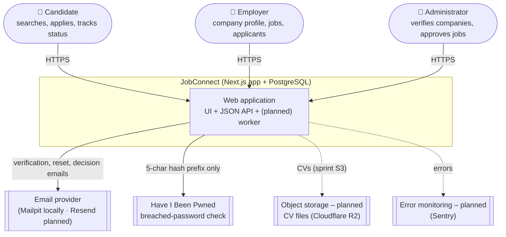
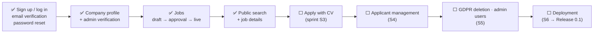

# JobConnect – Project Overview

| Field | Value |
|---|---|
| Version | 1.0 |
| Last updated | 2026-11-12 |
| Audience | Anyone new to the project |

## 1. In one paragraph
JobConnect is a job marketplace where **only verified employers can publish jobs** and **every
application shows its real status** from submission to decision. Candidates search and apply; employers
create a company profile, post jobs and manage applicants; administrators verify companies, approve jobs
and keep scams off the platform. It is a portfolio project built to production standard for the UK/EU
(GDPR), by one part-time developer working with an AI pair programmer.

## 2. The problem and the answer

| Problem (docs/02-product-strategy/01-vision.md) | JobConnect's answer |
|---|---|
| Candidates apply and never hear back | Status on every application, with every change shown and (later) notified |
| Employers lose applications in email | One applicant list per job, with a status workflow |
| Fake job adverts and scam employers | Company verification + admin approval of every job before it goes live |

## 3. System context

## 4. What exists today
See the live status in [00-solution-document.md §1](../00-solution-document.md#1-status-at-a-glance).
Summary at the time of writing:

## 5. Where to go next

| You want to… | Read |
|---|---|
| Know the current status and decisions | [00 Solution document](../00-solution-document.md) |
| Understand users and goals | [Personas](../02-product-strategy/02-personas.md), [User journeys](../02-product-strategy/03-user-journeys.md) |
| See what must be built | [Functional requirements](../03-requirements/01-functional-requirements.md), [Business rules](../03-requirements/03-business-rules.md) |
| See screens and flows | [UI flows](../04-design/01-ui-flows.md), [Screen inventory](../04-design/04-screen-inventory.md) |
| Understand the code | [Architecture](../06-architecture/01-system-architecture.md), [Codebase structure](../07-implementation/02-codebase-structure.md) |
| Run it locally | [Root README](../../README.md), [Development workflow](../07-implementation/04-development-workflow.md) |
| Check quality evidence | [Test strategy](../08-testing/01-test-strategy.md), [QA reports](../08-testing/qa-reports/) |
