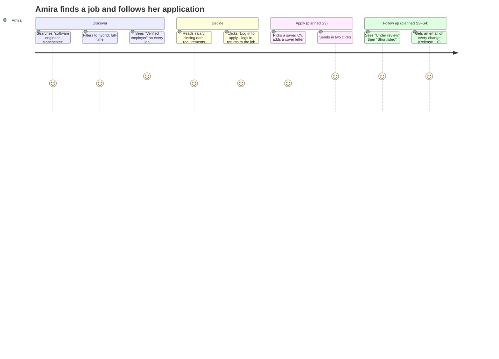
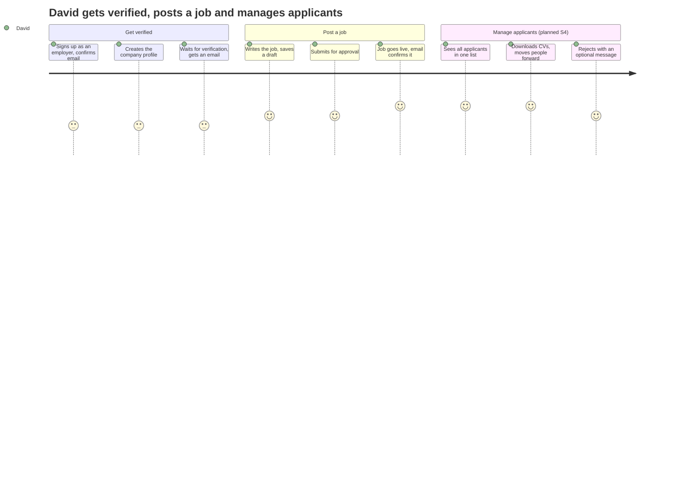
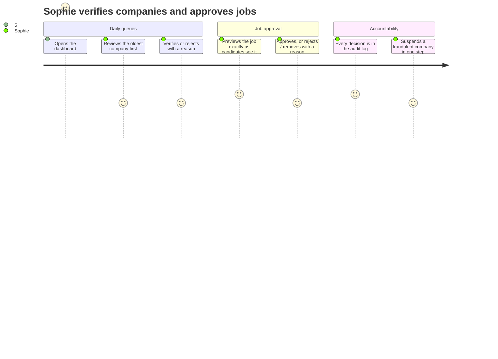
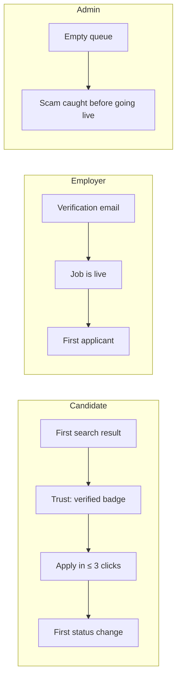

# User Journeys

| Field | Value |
|---|---|
| Version | 1.0 |
| Last updated | 2026-11-12 |
| Based on | [Personas](02-personas.md), [UI flows](../04-design/01-ui-flows.md) J1–J5 |

Journey maps show how each persona experiences JobConnect: the steps, how they feel (score 1–5, higher is
better) and where the product must remove friction. Steps marked *(planned)* are not built yet.

## 1. Amira – candidate: from search to a decision

| Pain point (persona) | Where the journey removes it |
|---|---|
| Applies to 30 jobs, hears back from 3 | Status timeline on every application (FR-CAN-013) |
| Re-types her history on every site | Saved profile and CVs (FR-CAN-001/005) |
| Once applied to a scam | Only verified companies, admin-approved jobs (FR-EMP-004, FR-ADM-009) |

## 2. David – employer: from sign-up to shortlist

| Pain point | Where the journey removes it |
|---|---|
| Applications lost in email | One applicant list per job (FR-EMP-014) |
| No overview for hiring managers | Status per applicant, dashboard (FR-EMP-023, Release 1.0) |
| Unclear why something was refused | Every rejection by an admin carries a reason (BR-CMP-002, BR-JOB-008) |

## 3. Sophie – administrator: keeping scams out

## 4. Moments that matter

Each "moment that matters" has a measure in [07-roadmap-and-kpis.md](07-roadmap-and-kpis.md).
