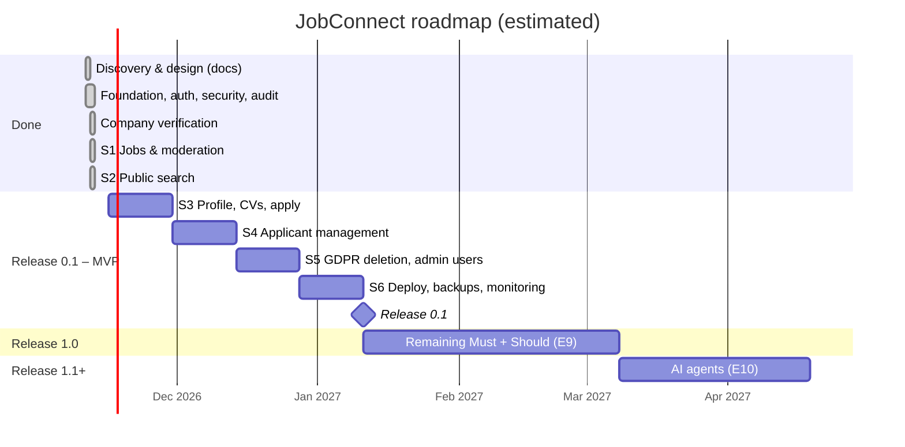

# Roadmap and Success Measures

| Field | Value |
|---|---|
| Version | 1.0 |
| Last updated | 2026-11-12 |
| Source of truth for sprints | [07-implementation/01-agile-methodology.md §15](../07-implementation/01-agile-methodology.md#15-release-plan) |

## 1. Roadmap

Dates after today are **estimates** at 10 hours/week and 2-week sprints; they are re-planned at every
sprint review once real velocity is measured.

| Release | Contents | Exit criteria |
|---|---|---|
| **0.1 – MVP** | Core loop (epics E0–E8) | docs/02-product-strategy/06-mvp-definition.md §5 all ticked |
| **1.0 – Full** | All Must + Should requirements | Every Must/Should FR and NFR done and tested |
| **1.1+ – Smart** | AI agents, Could items | AI NFRs (docs/03-requirements/02-non-functional-requirements.md §9) met |

## 2. Success measures (KPIs)

Measured from Release 0.1. Targets are starting hypotheses for a small launch and will be revised with data.

| Area | KPI | Definition | Initial target | Moment that matters |
|---|---|---|---|---|
| Trust | Jobs from verified companies | Published jobs whose company is VERIFIED | **100 %** (enforced) | Verified badge |
| Trust | Scam jobs caught before going live | Jobs rejected/removed for policy ÷ jobs submitted | Tracked, no target | Scam caught |
| Speed | Time to verify a company | Median submitted → verified | < 1 working day | Verification email |
| Speed | Time to approve a job | Median submitted → published | < 1 working day | Job is live |
| Candidate | Apply conversion | Applications ÷ job-detail views by logged-in candidates | Tracked | Apply in ≤ 3 clicks |
| Candidate | Status transparency | Applications with ≥ 1 status change within 14 days | > 50 % | First status change |
| Employer | Time to first applicant | Median published → first application | Tracked | First applicant |
| Quality | Search speed | p95 of `/api/v1/jobs` at 10,000 jobs | < 500 ms (**measured 4.5 ms**, D-24) | First search result |
| Quality | Uptime | Monthly availability | 99.5 % (NFR-REL-001) | – |
| Quality | Escaped defects | Bugs found after merge per sprint | ↓ over time | – |

Delivery metrics (velocity, CI pass rate, lead time) are in
[07-implementation/01-agile-methodology.md §16](../07-implementation/01-agile-methodology.md#16-metrics).

**Analytics note:** collecting these needs privacy-respecting measurement (aggregate counts from our own
database first; no third-party tracking without consent – docs/12-audit/03-privacy-gdpr-audit.md).
