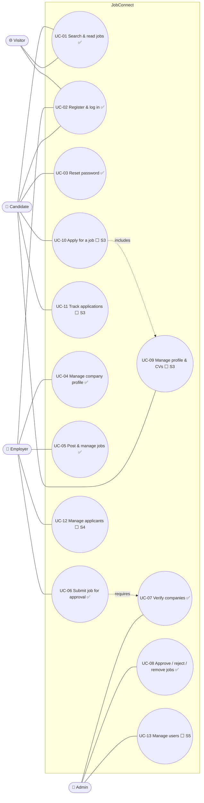

# Use Cases

| Field | Value |
|---|---|
| Version | 1.0 |
| Last updated | 2026-11-12 |
| Traces to | [Functional requirements](01-functional-requirements.md), [Business rules](03-business-rules.md) |

Legend: ✅ built · ⬜ planned (sprint in brackets)

## 1. Use-case diagram

## 2. Use-case specifications

### UC-01 Search and read jobs ✅
| | |
|---|---|
| **Actor** | Visitor or any logged-in user |
| **Requirements** | FR-CAN-006/007/008, BR-JOB-001, BR-CMP-003, BR-USR-002 |
| **Precondition** | None |
| **Main flow** | 1. Actor enters keyword and/or location, optional work modes and job types. 2. System lists visible jobs, newest first, 20 at a time, with a total. 3. Actor opens a job. 4. System shows the full job with company, salary, closing date. |
| **Alternatives** | 2a. No match → "No jobs match. Try removing a filter." + Clear filters. 2b. More than 20 → "Load more". 3a. Job not visible (paused, closed, suspended company, unknown id) → real 404. |
| **Postcondition** | None (read-only) |

### UC-02 Register and log in ✅
| | |
|---|---|
| **Actor** | Visitor → Candidate or Employer |
| **Requirements** | FR-AUTH-001…007, NFR-PRV-002 |
| **Main flow** | 1. Visitor chooses role, enters name, email, password, accepts the privacy policy. 2. System checks password rules and breach list, creates the account, emails a link valid 24 h. 3. Visitor confirms the email. 4. Visitor logs in and lands on their role's home. |
| **Alternatives** | 2a. Email already registered → same "check your email" screen; the owner is emailed instead (no enumeration, D-11). 4a. Not confirmed → refused, new link sent. 4b. Wrong password → generic error. 4c. Suspended → "This account can't sign in". 4d. Came from "Log in to apply" → returns to that job. |

### UC-03 Reset password ✅
| | |
|---|---|
| **Requirements** | FR-AUTH-008 |
| **Main flow** | 1. User asks for a reset link. 2. System always answers "If an account exists…", emails a link valid 1 h. 3. User sets a new password. 4. System revokes all sessions. |

### UC-04 Manage company profile ✅
| | |
|---|---|
| **Actor** | Employer |
| **Requirements** | FR-EMP-001/003/004, BR §2 |
| **Main flow** | 1. Employer creates the profile (name, description, industry, size, location, website). 2. Company enters PENDING. 3. After a decision the employer sees the status and any reason. |
| **Alternatives** | 1a. Second company → 409. 3a. REJECTED → edit and resubmit → PENDING. 3b. SUSPENDED → no edits. |

### UC-05 Post and manage jobs ✅ / UC-06 Submit for approval ✅
| | |
|---|---|
| **Actor** | Employer |
| **Requirements** | FR-EMP-006…011, BR §3, BR-CMP-001 |
| **Main flow** | 1. Employer writes a job (draft allowed before verification). 2. Submits it (company VERIFIED, deadline 1–90 days away). 3. After approval: pause/resume, edit, close. |
| **Alternatives** | 2a. Not verified → 422 "Available once your company is verified". 3a. Material edit of a live job → back to approval (BR-JOB-004). 3b. Close is final (BR-JOB-007). |

### UC-07 Verify companies ✅ / UC-08 Moderate jobs ✅
| | |
|---|---|
| **Actor** | Admin |
| **Requirements** | FR-ADM-007…011, BR-CMP-002, BR-JOB-008 |
| **Main flow** | 1. Admin opens the queue (oldest first). 2. Reviews the company / the job as candidates will see it. 3. Decides; reasons are required for reject / suspend / remove. 4. Decision and audit entry commit together; employer is emailed. |
| **Alternatives** | 3a. Another admin decided first → 409 "updated by someone else". 3b. Job's company no longer verified → approval refused. |

### UC-09 … UC-13 ⬜ planned
Specifications are written with their sprint (S3–S5) and follow J4–J5 in
[04-design/01-ui-flows.md](../04-design/01-ui-flows.md#3-core-loop-journeys).
