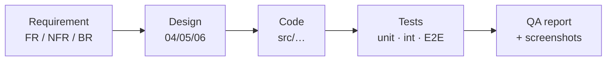

# Requirements Traceability Matrix

| Field | Value |
|---|---|
| Version | 1.0 |
| Last updated | 2026-11-12 |
| Scope | MVP requirements (docs/02-product-strategy/06-mvp-definition.md §4) |

Each requirement → where it is designed → where it is implemented → how it is proven.
Status per [00 §6](../00-solution-document.md#6-requirements-traceability).
Paths: `int` = `*.int.test.ts` (real PostgreSQL), `E2E nn` = numbered Playwright step with screenshot.

## 1. Functional

| Req | Design | Implementation | Tests | Status |
|---|---|---|---|---|
| FR-AUTH-001 | API §4.1, UI J4 | `src/lib/auth.ts`, `(auth)/register` | int `auth`, E2E 02–04 | ✅ |
| FR-AUTH-002 | BR §5 | `modules/auth/signup-rules.ts` | unit, int | ✅ |
| FR-AUTH-003 | NFR-SEC-001 | `modules/auth/password.ts`, HIBP plugin | unit, int | ✅ |
| FR-AUTH-004 | D-11 | Better Auth + `citext` UNIQUE | int | ✅ |
| FR-AUTH-005/006 | Seq. diagram §1 | `lib/auth.ts` emailVerification | E2E 05–07 | ✅ |
| FR-AUTH-007 | – | `sign-out-button.tsx` | E2E 09–10 | ✅ |
| FR-AUTH-008 | – | `lib/auth.ts` reset; `(auth)/reset-password` | E2E 11–14 | ✅ |
| FR-EMP-001/003 | Data §3.5, API §4.6 | `modules/company/*`, `/employer/company` | int `company`, E2E 20–22, 28–29 | ✅ |
| FR-EMP-004 | BR-CMP-001 | `job/service.ts` submit/resume/approve checks | int `job` | ✅ |
| FR-EMP-006…011 | Data §3.6, API §4.7, state §3 | `modules/job/*`, `/employer/jobs/*` | unit `job/rules`, int `job`, E2E 40–52 | ✅ |
| FR-EMP-013 | API §4.7 | `listMyJobs` (`_count.applications`) | E2E 40, 49, 89 | ✅ |
| FR-ADM-007/008 | API §4.9, seq. §3 | `company/service.ts` decideCompany, `/admin/companies/*` | int, E2E 23–31 | ✅ |
| FR-ADM-009…011 | API §4.9, seq. §4 | `job/service.ts` decideJob, `/admin/jobs/*` | int, E2E 46–52 | ✅ |
| FR-ADM-019/021 | Data §3.10, 12-audit/01 | `modules/audit/audit.ts`, migration triggers | int `audit` | 🟡 more actions per feature |
| FR-CAN-006…008 | Data §5 Q1, API §4.4 | `modules/job/search.ts`, `/jobs`, `/jobs/[id]` | int `search`, E2E 60–72 | ✅ |
| FR-CAN-001 | API §4.3 | `modules/candidate/service.ts`, `/candidate/profile` | int, E2E 80–81 | ✅ |
| FR-CAN-005 | API §4.3, NFR-SEC-008 | `candidate/cv-file.ts` (content type), `lib/storage.ts`, `CvManager` | unit, int (5-CV race), E2E 82–83 | ✅ |
| FR-CAN-010…012 | BR-APP-001…003, seq. §6 | `modules/application/service.ts` applyForJob, `ApplyForm` | int (once, race, snapshot, deadline), E2E 84–86 | ✅ |
| FR-CAN-013 | UI §4.3 | `/candidate/applications`, `[id]` timeline | int (privacy), E2E 85, 87–88 | ✅ |
| FR-EMP-014/015/017/018 | UI J5, API §4.8 | – | – | ⬜ S4 |
| FR-CAN-017/018, FR-ADM-004…006 | Data §6 | – | – | ⬜ S5 |

## 2. Non-functional (Must, built so far)

| Req | Implementation | Proof | Status |
|---|---|---|---|
| NFR-SEC-001 | Argon2id (OWASP params) | unit `password` | ✅ |
| NFR-SEC-003 | proxy gate + `apiRoute` + service `requireRole`/ownership | int (403/404 per role), E2E 32, 53, 67 | ✅ |
| NFR-SEC-004 | Zod on every body; Prisma / bound SQL params | unit schemas, int "SQL-looking input" | ✅ |
| NFR-SEC-005 | Nonce CSP | unit `csp`, E2E 18, 71 (real browser) | ✅ |
| NFR-SEC-006 | Cookie flags, Origin check | unit `csrf` | ✅ |
| NFR-SEC-007 | DB rate limits (auth) | E2E observed 429 → reset helper | 🟡 public API limit ⬜ |
| NFR-SEC-010 | env vars, gitleaks | CI | ✅ |
| NFR-PRV-002 | consent version + timestamp | int `auth` | ✅ |
| NFR-PRV-004 | logger redaction, audit metadata guard | unit `logger`, `audit` | ✅ |
| NFR-PERF-001 (S) | GIN on stored `search_vector` | `npm run perf:search` | ✅ |
| NFR-OBS-001/002 | `/api/health`, pino + request id | unit `health`, manual | ✅ |
| NFR-MNT-001/002 | TS strict, ESLint, CI | CI | ✅ |
| NFR-UX-001 | responsive Tailwind | E2E 17, 69–70 (360 px) | 🟡 per screen |

Gaps and plans: [00 §14](../00-solution-document.md#14-open-questions-risks-and-next-steps).
