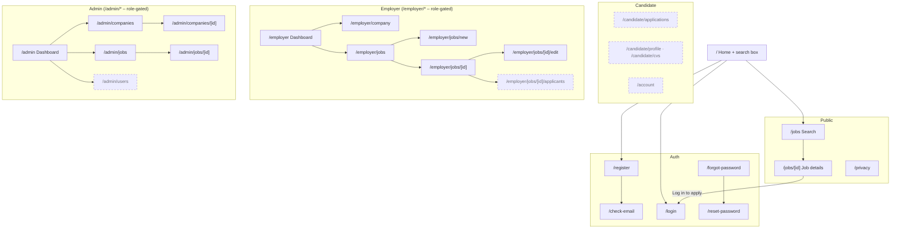
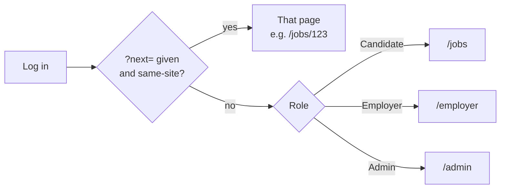

# Sitemap and Navigation

| Field | Value |
|---|---|
| Version | 1.0 |
| Last updated | 2026-11-12 |
| Planned design | [01-ui-flows.md §2](01-ui-flows.md#2-site-map) |

## 1. Sitemap (as built + planned)

Solid boxes are built; dashed are planned.

## 2. Where each role lands after login (docs/11 §2, D-19, D-29)

## 3. Navigation per role (as built)

| Role | Header links (left) | Header (right) |
|---|---|---|
| Visitor | – | Find jobs · Log in · **Sign up** |
| Candidate | Find jobs | name · Candidate · Log out |
| Employer | Dashboard · Jobs · Company | name · Employer · Log out |
| Admin | Dashboard · Companies · Jobs | name · Admin · Log out |

Planned: candidate bottom tab bar on phones (Find jobs · Applied · Me) – [01-ui-flows.md §2.1](01-ui-flows.md#21-navigation-per-role).

## 4. Access rules (who can open what)

| Area | Visitor | Candidate | Employer | Admin | Enforced by |
|---|---|---|---|---|---|
| `/`, `/jobs`, `/jobs/[id]`, auth pages | ✅ | ✅ | ✅ | ✅ | – |
| `/employer/*` | → login | 404 | ✅ own data only | 404 | proxy gate + page + service |
| `/admin/*` | → login | 404 | 404 | ✅ | proxy gate + page + service |
| Another employer's job page | → login | 404 | not-found screen (D-20) | 404 | service ownership |
