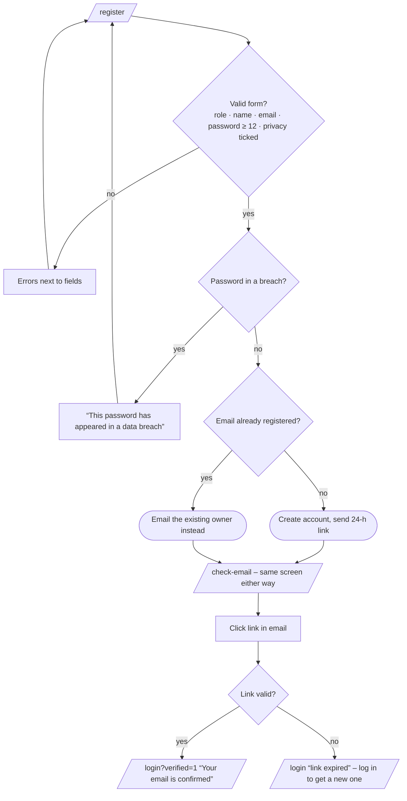
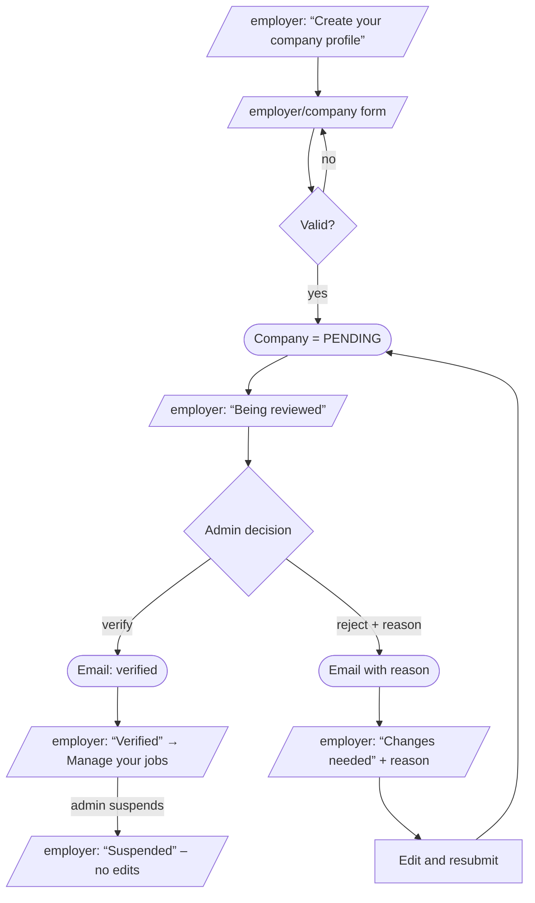
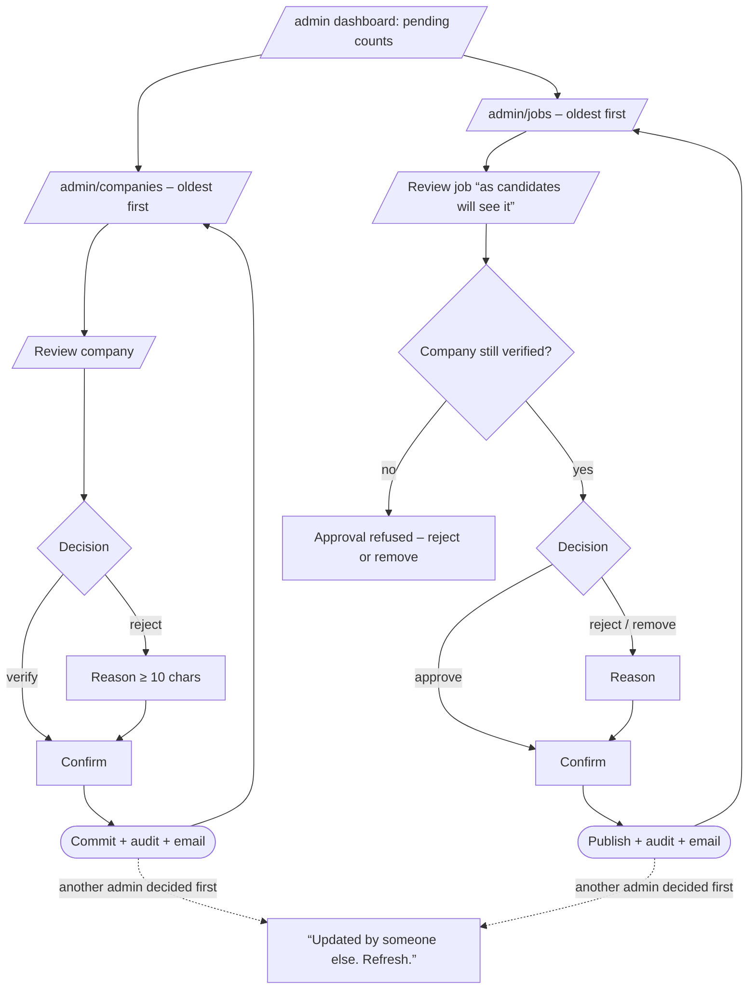
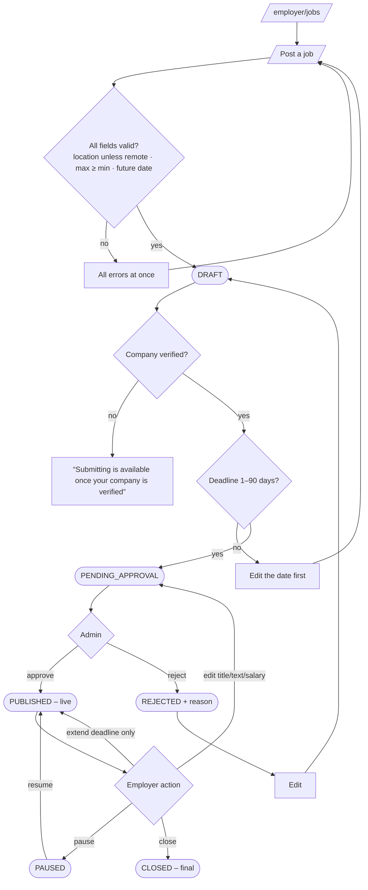
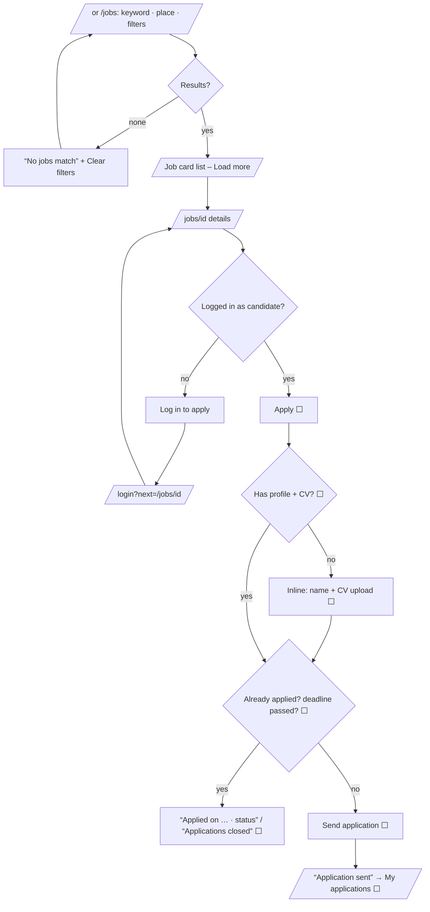
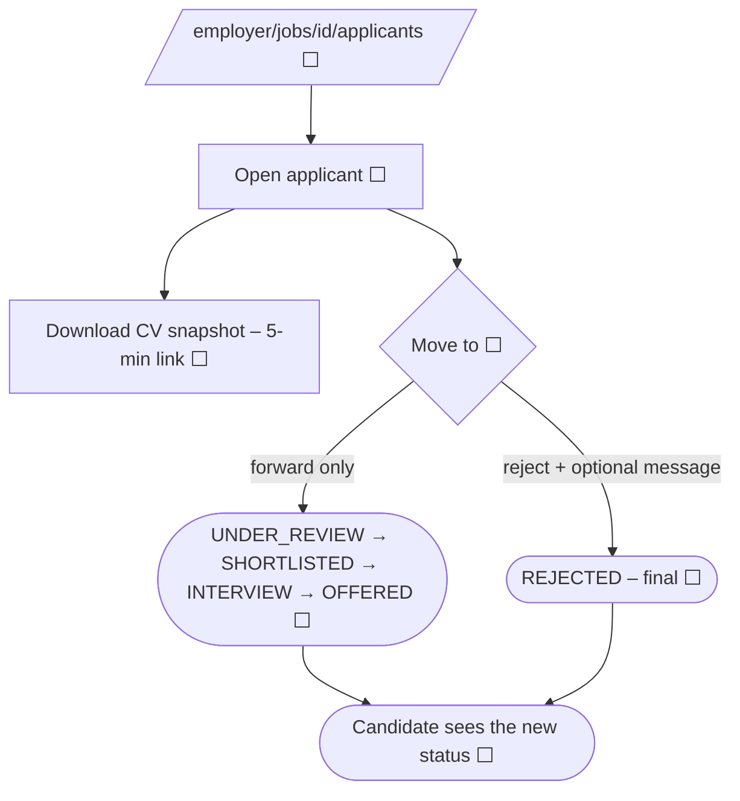

# User-Flow Diagrams

| Field | Value |
|---|---|
| Version | 1.0 |
| Last updated | 2026-11-12 |
| Journeys | J1–J5 in [01-ui-flows.md §3](01-ui-flows.md#3-core-loop-journeys) |

Screens are rectangles, decisions diamonds, system actions rounded. ⬜ = planned.

## J0 – Sign up and confirm email ✅

## J1 – Employer gets verified ✅

## J2 – Admin verifies a company and approves a job ✅

## J3 – Employer posts and manages a job ✅

## J4 – Candidate finds a job ✅ and applies ⬜

## J5 – Employer reviews applicants ⬜ (S4)

