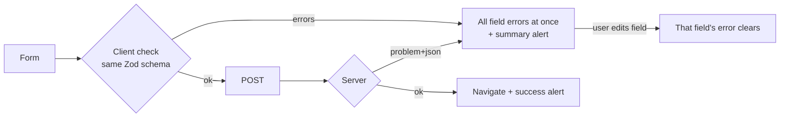

# Design System

| Field | Value |
|---|---|
| Version | 1.0 |
| Last updated | 2026-11-12 |
| Implementation | Tailwind CSS 4 utility classes; components in `src/components/` |

A small, accessible system: neutral zinc palette, one accent for status meaning, system fonts, generous touch
targets. Brand identity is still an open question (00 §14 Q3) – this system is deliberately neutral so a brand
can be applied later through the tokens below.

## 1. Tokens

| Token | Light | Dark | Use |
|---|---|---|---|
| Background | `zinc-50` | `black` | Page |
| Surface | `white` | `zinc-950` | Cards, forms, tables |
| Border | `zinc-200` / inputs `zinc-300` | `zinc-800` / `zinc-700` | Separation |
| Text | `zinc-900` | `zinc-100` | Body, headings |
| Muted text | `zinc-600` | `zinc-400` | Hints, metadata |
| Primary action | `zinc-900` bg / white text | `zinc-100` bg / `zinc-900` text | One per screen |
| Success | `green-50/300/800` | `green-950/900/200` | Verified, Live, saved |
| Warning | `amber-50/300/900` | `amber-950/900/200` | Pending, being reviewed |
| Danger | `red-50/300/800` | `red-950/900/200` | Errors, rejected, removed |
| Radius | `rounded-lg` (controls), `rounded-2xl` (cards) | | |
| Focus | 2 px outline, offset 1–2 px, `zinc-900` / `zinc-100` | | Every interactive element |

Colour is **never the only signal** – every status badge has text (docs/11 P6).

## 2. Typography
System sans-serif stack (Geist variables loaded, fallback system UI). Scale: page title `text-3xl/4xl
semibold tracking-tight`; section `text-lg/2xl semibold`; body `text-base`; metadata `text-sm`; hints
`text-xs`. Inputs use `text-base` so phones don't zoom on focus.

## 3. Components

| Component | File | Notes |
|---|---|---|
| Button | `components/ui/button.tsx` | `primary` / `secondary`; `loading` shows a spinner and sets `aria-busy`; min height 44 px |
| Text field | `components/ui/text-field.tsx` | Label always visible; hint + error linked with `aria-describedby`; `aria-invalid` |
| Select field | `components/ui/select-field.tsx` | Same contract as text field |
| Textarea field | `components/ui/textarea-field.tsx` | Same contract as text field |
| Alert | `components/ui/alert.tsx` | `error` → `role=alert`; `success`/`info` → `role=status` |
| Status badge | `components/ui/status-badge.tsx` | Tone + text; labels from `modules/*/labels.ts` |
| Action panel | `components/action-panel.tsx` | Choose → confirm (names the consequence) → optional reason → POST |
| Auth card | `components/auth-card.tsx` | Centred card for auth screens |
| Site header | `components/site-header.tsx` | Role navigation; links never wrap at 360 px |
| Job card / preview / search form | `modules/job/components/` | Search result, full job, GET search form |

## 4. Patterns

| Pattern | Rule |
|---|---|
| Forms | Validate with the same Zod schema as the server; show all errors at once; clear an error as soon as its field is edited |
| Destructive / final actions | Two steps: choose, then "Confirm: …" with the consequence stated |
| Lists | Table on desktop with a visually-hidden caption; empty state with a next step |
| Status | Badge + one sentence of "what happens next" |
| Phones | 16 px gutters; sticky primary action at the bottom where it matters (job details) |

## 5. Wireframe → build
Planned wireframes: [01-ui-flows.md §4](01-ui-flows.md#4-key-screens-wireframes). As built: the screenshots in
[04-screen-inventory.md](04-screen-inventory.md).
