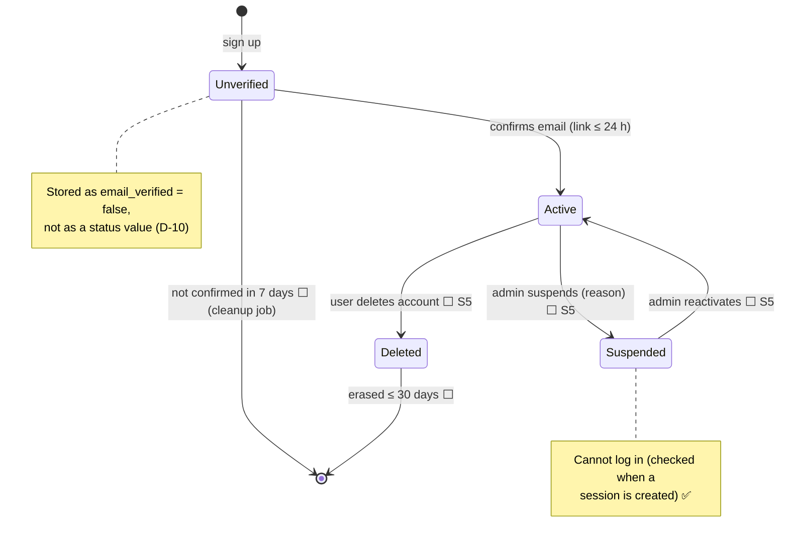
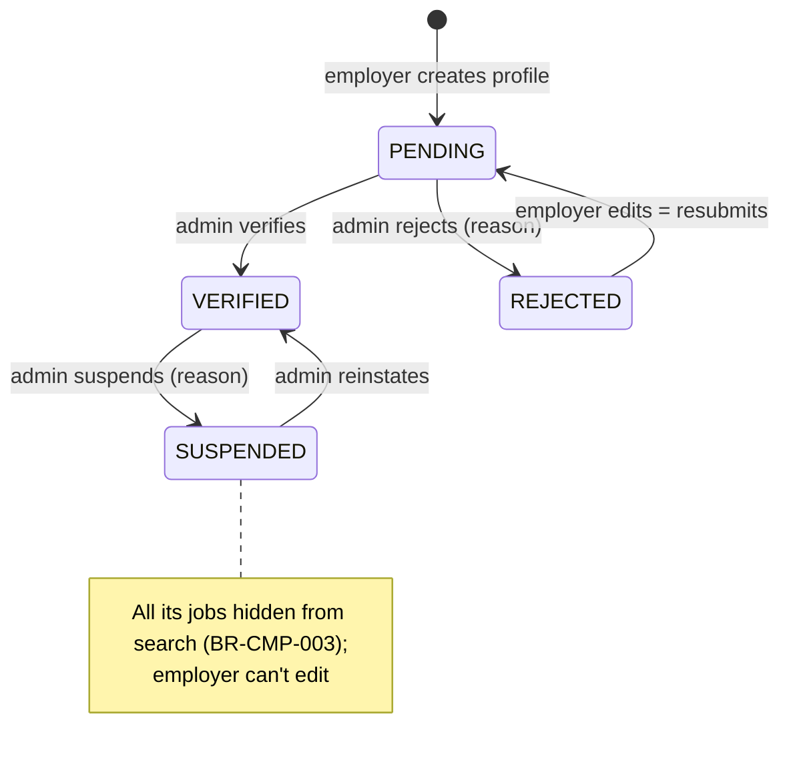
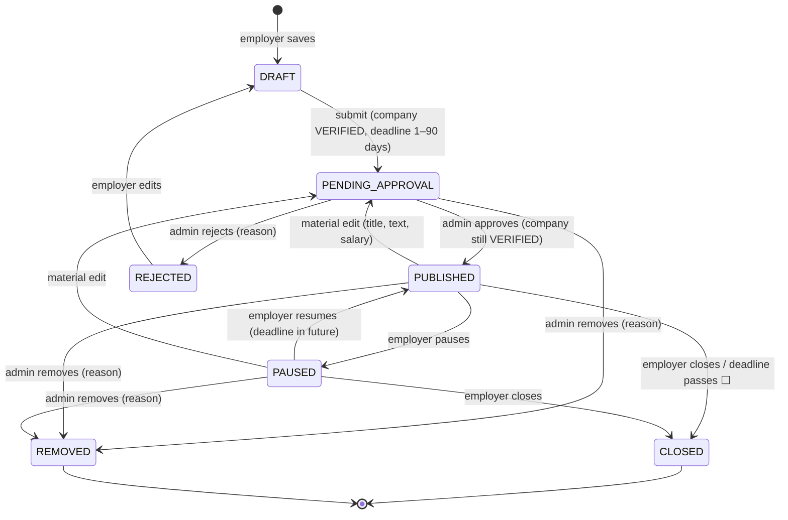
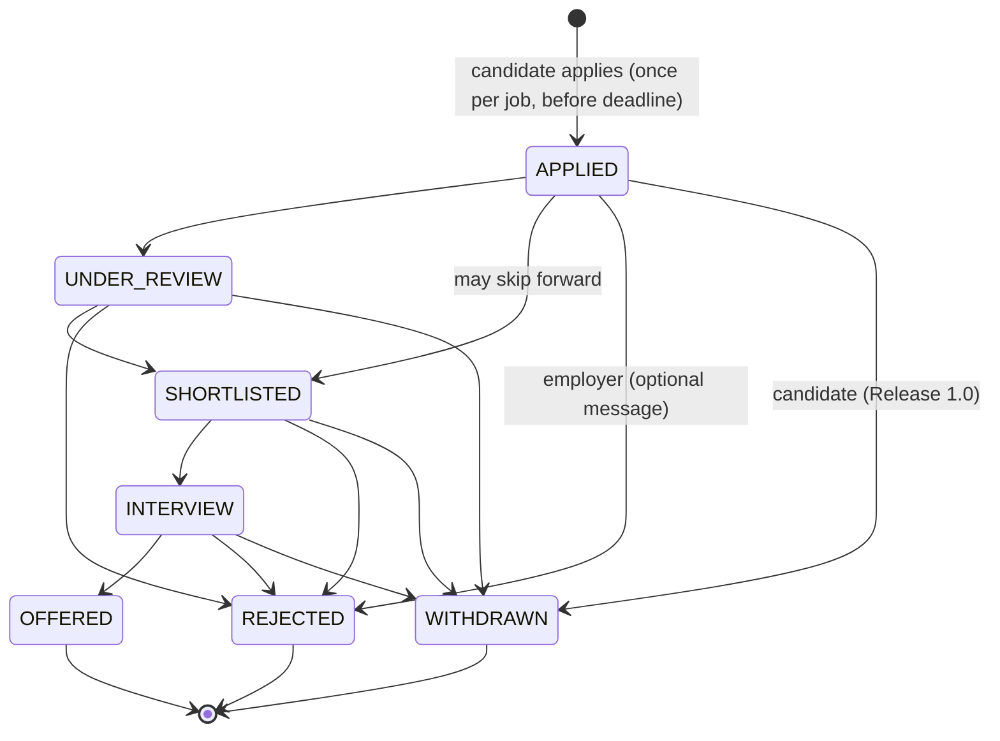

# State Diagrams

| Field | Value |
|---|---|
| Version | 1.0 |
| Last updated | 2026-11-12 |
| Rules | [03-requirements/03-business-rules.md](../03-requirements/03-business-rules.md) §1–4 |
| Code | Transition tables: `src/modules/company/rules.ts`, `src/modules/job/rules.ts` |

Every lifecycle is one transition table in code; services refuse anything not in the table and apply changes
with a **guarded update** (`WHERE status = <expected>`), so two people can't both win (docs/05-design/01-data-model.md §4).

## 1. User account ✅ (BR §1)

## 2. Company verification ✅ (BR §2)

## 3. Job ✅ (BR §3)

Visible to the public only when `PUBLISHED` **and** deadline in the future **and** company VERIFIED **and**
owner ACTIVE (`VISIBLE_JOB`, D-25).

## 4. Application ⬜ (BR §4 – sprint S3/S4)

Forward-only; OFFERED, REJECTED and WITHDRAWN are final (BR-APP-004/005).
