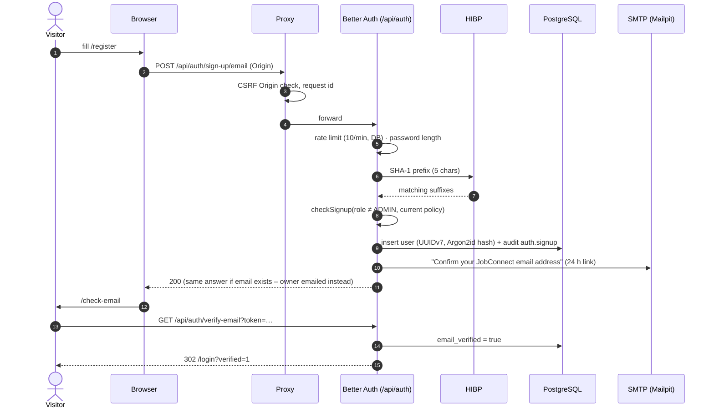
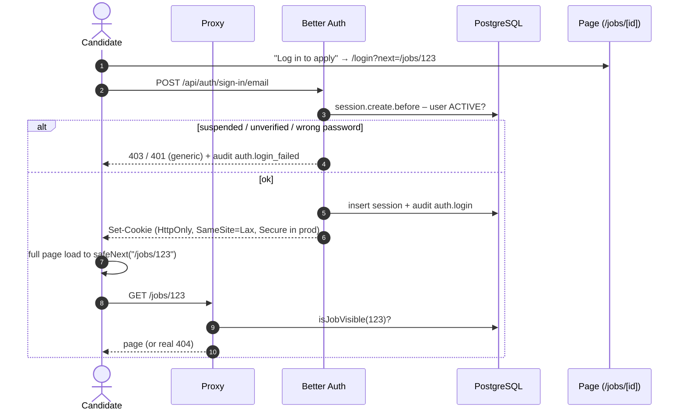
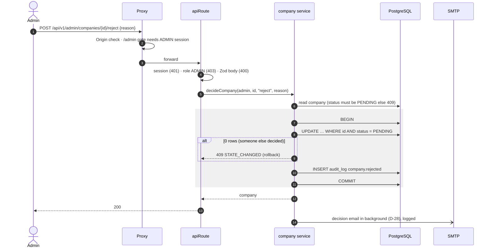
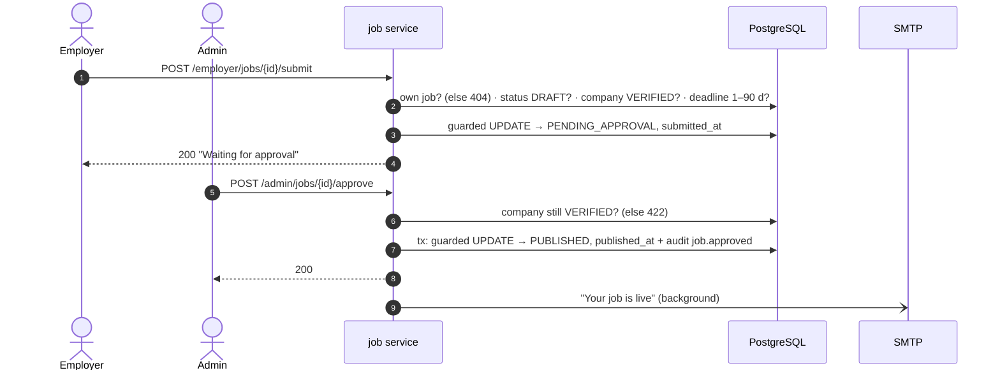
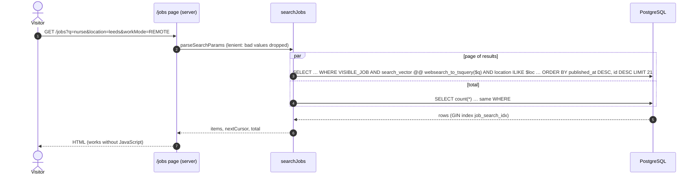
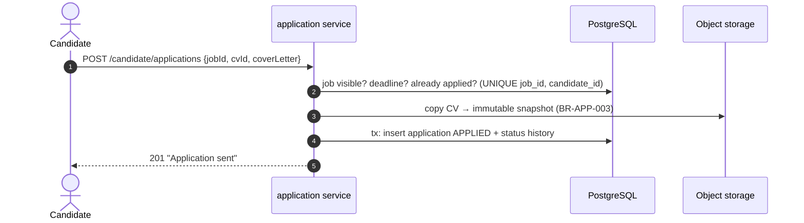

# Sequence Diagrams

| Field | Value |
|---|---|
| Version | 1.0 |
| Last updated | 2026-11-12 |
| Components | [06-architecture/02-c4-diagrams.md](../06-architecture/02-c4-diagrams.md) |

## 1. Sign up and email verification ✅

## 2. Log in to a protected page ✅

## 3. Admin decides on a company ✅

## 4. Employer submits → admin approves a job ✅

## 5. Public search ✅

## 6. Apply for a job ⬜ (sprint S3 – design)

