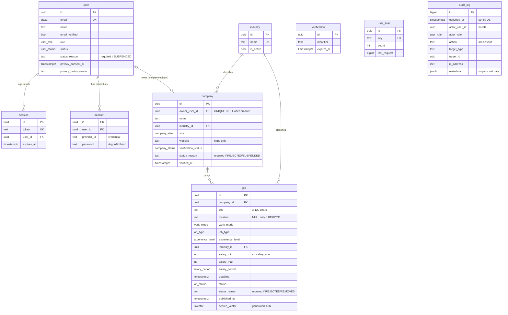
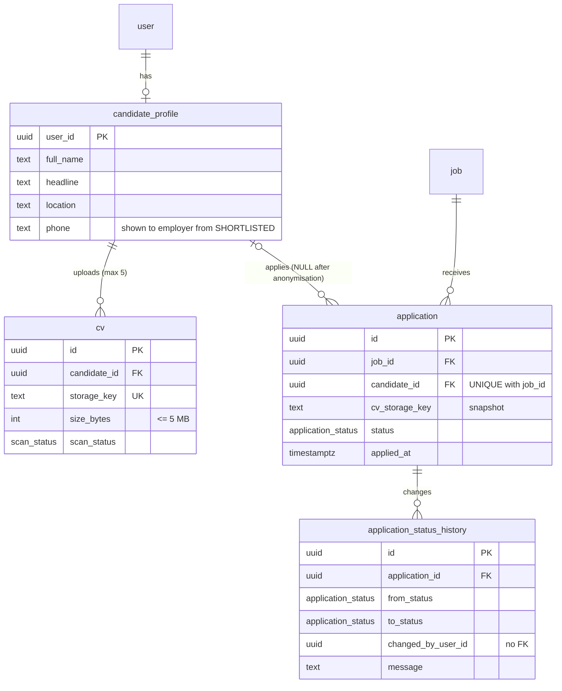

# Entity-Relationship Diagrams

| Field | Value |
|---|---|
| Version | 1.0 |
| Last updated | 2026-11-12 |
| Source of truth | `prisma/schema.prisma` + `prisma/migrations/` · column detail in [01-data-model.md](01-data-model.md) |

## 1. As built (7 migrations)

`verification`, `rate_limit` and `audit_log` deliberately have **no foreign keys**: tokens and counters are
looked up by key, and audit entries must survive user deletion and are never updated (FR-ADM-021).

## 2. Planned additions (sprints S3–S4, docs/05-design/01-data-model.md §3.2–3.8)

