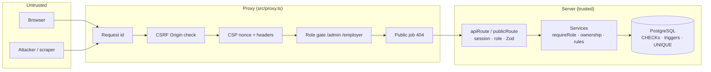

# Security Design

| Field | Value |
|---|---|
| Version | 1.0 |
| Last updated | 2026-11-12 |
| Requirements | NFR-SEC-001…011, NFR-PRV-001…006 |
| Audit | [12-audit/02-security-audit.md](../12-audit/02-security-audit.md) |

## 1. Trust boundaries

**Defence in depth for authorisation (NFR-SEC-003):** every protected action is checked at three layers –
the proxy (area), the route wrapper (session + role), the service (role + ownership) – and the database
enforces the rules that matter most (constraints, append-only audit). The frontend is never trusted.

## 2. Threat model (STRIDE)

| Threat | Example | Mitigation | Status |
|---|---|---|---|
| **S**poofing | Password guessing, credential stuffing | Argon2id, ≥ 12 chars, HIBP, 10/min rate limit, generic errors | ✅ |
| **S**poofing | Session theft via XSS | HttpOnly cookies + nonce CSP | ✅ |
| **T**ampering | Employer edits another company's job | Ownership in service → 404; tests per role | ✅ |
| **T**ampering | Two admins decide at once | Guarded update + transaction | ✅ |
| **T**ampering | SQL injection in search | Bound parameters only; Zod; tests with SQL-looking input | ✅ |
| **R**epudiation | Admin denies a decision | Append-only audit log in the same transaction | ✅ |
| **I**nformation disclosure | Account enumeration | Same response for sign-up / reset whether the email exists | ✅ |
| **I**nformation disclosure | Hidden job/company leaks | `VISIBLE_JOB` rule; public field allow-list; 404 not 403 | ✅ |
| **I**nformation disclosure | Personal data in logs | Redaction (also nested); no PII in audit metadata | ✅ |
| **I**nformation disclosure | CV access by the wrong person | Private bucket, 5-min signed URLs, ownership check | ⬜ S3 |
| **D**enial of service | Brute force on auth | DB-backed rate limits | ✅ |
| **D**enial of service | Search scraping / flooding | General 120/min limit on public API | ⬜ before release |
| **E**levation of privilege | Self-register as admin | Role allow-list at sign-up; admins by script only | ✅ |
| **E**levation of privilege | Open redirect after login | `safeNext` (blocks `//` and `/\`) | ✅ |
| Supply chain | Malicious / broken dependency | Pin ≥ 2-week-old releases; Dependabot + CI; gitleaks; SHA-pinned Actions | ✅ |

## 3. Data classification

| Class | Examples | Handling |
|---|---|---|
| Secret | Password hashes, session tokens, `BETTER_AUTH_SECRET` | Never logged; hashes Argon2id; secrets in env only |
| Personal | Name, email, phone, IP, CVs (planned) | Minimised; redacted in logs; erasure ≤ 30 days (planned); contact details to employers only from SHORTLISTED |
| Business | Company and job data | Public only when verified/visible |
| Audit | `audit_log` | Append-only; 24-month retention; no personal data in metadata |

## 4. Security headers (as built)
`Content-Security-Policy` (nonce, `strict-dynamic`, `frame-ancestors 'none'`), `Strict-Transport-Security`
(production), `X-Content-Type-Options: nosniff`, `X-Frame-Options: DENY`, `Referrer-Policy:
strict-origin-when-cross-origin`, `Permissions-Policy` (camera, microphone, geolocation… off),
`Cross-Origin-Opener-Policy: same-origin`, no `X-Powered-By`.
