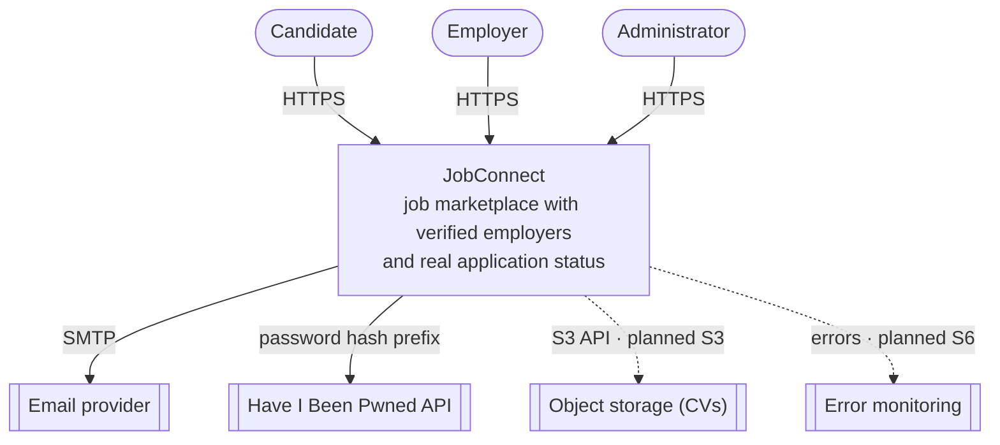
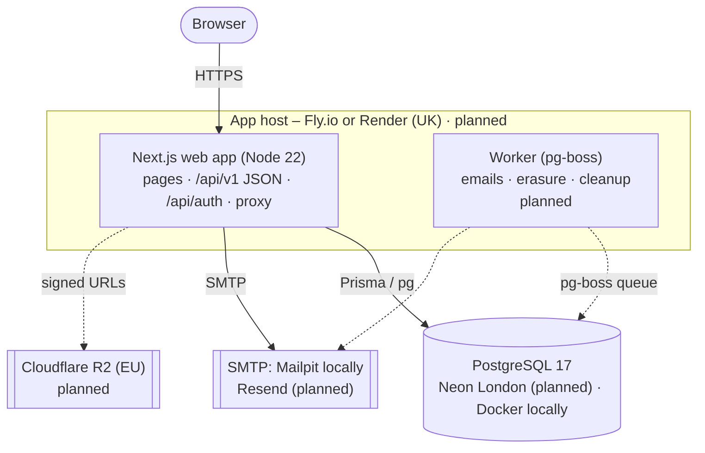
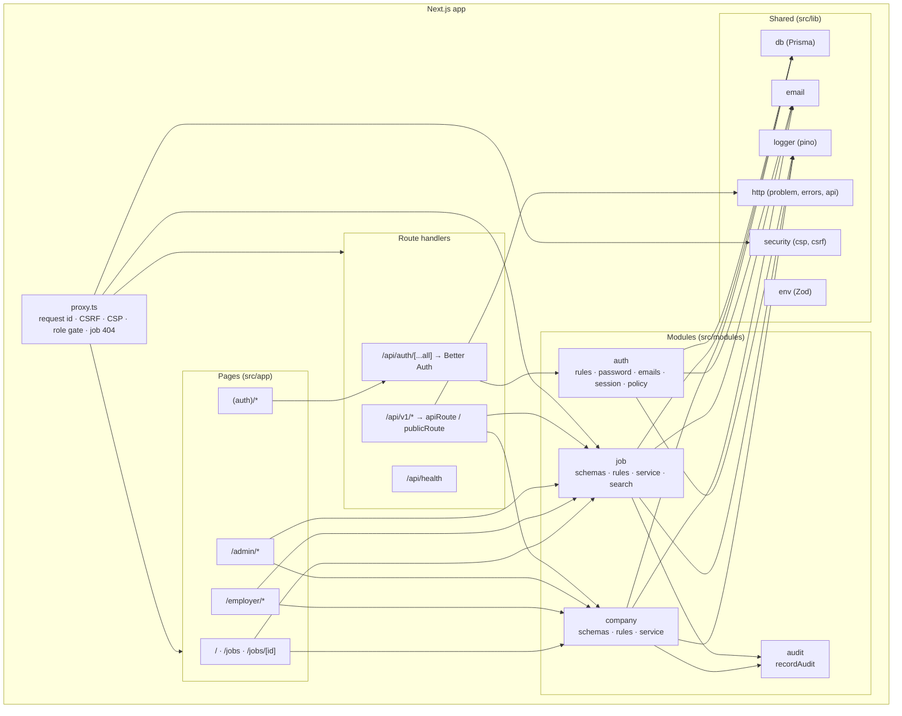

# C4 Architecture Diagrams

| Field | Value |
|---|---|
| Version | 1.0 |
| Last updated | 2026-11-12 |
| Narrative | [01-system-architecture.md](01-system-architecture.md) |

C4 model: **Context** (the system and its neighbours) → **Containers** (deployable units) → **Components**
(modules inside the app). Dashed = planned.

## Level 1 – System context

## Level 2 – Containers

## Level 3 – Components of the web app

**Dependency rule:** pages and route handlers → modules → lib. Modules call each other only through
service functions (e.g. job service reads company status, never company internals).
