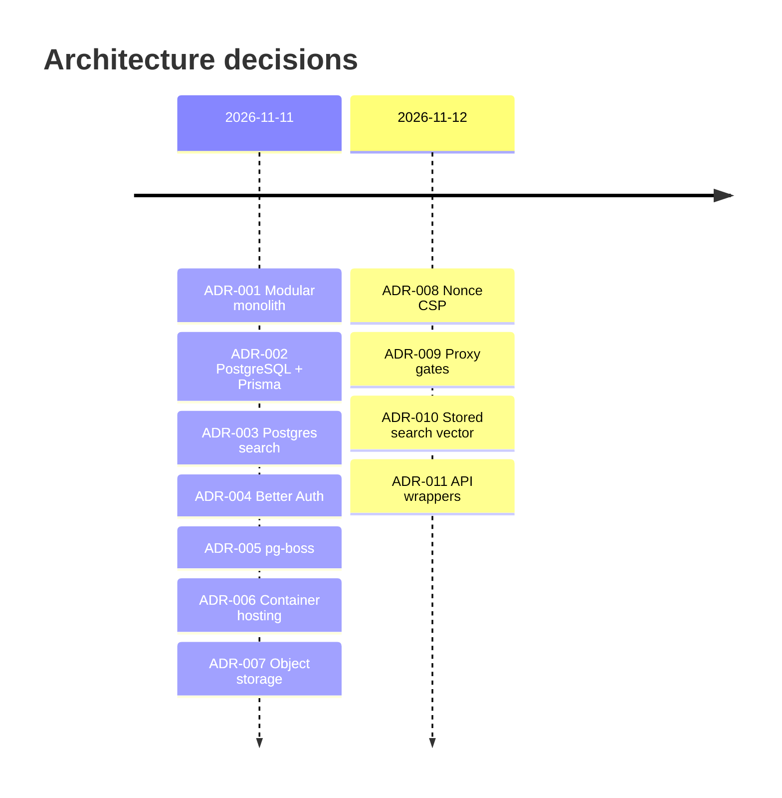

# Architecture Decision Records

| Field | Value |
|---|---|
| Version | 1.0 |
| Last updated | 2026-11-12 |
| Summary table | [01-system-architecture.md §9](01-system-architecture.md#9-architecture-decision-records-summary) |
| Product decisions (D-NN) | [00 §12](../00-solution-document.md#12-decision-log) |

Format: context → decision → options → consequences. Status: **Accepted** unless noted.

---

## ADR-001 Modular monolith on Next.js
- **Context:** one part-time developer, < £20/month, TypeScript, same-origin cookies.
- **Decision:** one Next.js app (UI + API + later worker) in one image; code split into modules with
  service boundaries.
- **Options:** React SPA + NestJS API (two deploys, CORS/cookie complexity); microservices (far too heavy).
- **Consequences:** + simplest build/deploy, one language, CSRF simpler. − a bug can affect the whole app
  (mitigated by tests); Next.js learning curve.

## ADR-002 PostgreSQL + Prisma
- **Context:** relational data, transactions for status changes, DB-level audit protection.
- **Decision:** PostgreSQL 17 with Prisma 7 (`@prisma/adapter-pg`); hand-written SQL in migrations for
  CHECKs, triggers, partial indexes.
- **Options:** MongoDB (no relational integrity); raw SQL only (less type safety).
- **Consequences:** + typed queries, constraints in the DB. − Prisma can't express everything (we use raw SQL
  where needed); Prisma 7 needs `prisma generate` after migrate (D-08).

## ADR-003 PostgreSQL full-text search
- **Context:** 10,000 jobs, p95 < 500 ms (NFR-PERF-001).
- **Decision:** `tsvector` + GIN in PostgreSQL; no separate search engine.
- **Options:** Elasticsearch / Meilisearch (another service and bill).
- **Consequences:** + one database; measured 4.5 ms p95 (ADR-010). − limited relevance tuning; revisit at
  millions of jobs.

## ADR-004 Better Auth with database sessions
- **Context:** email verification, reset, rate limits, breached-password check, MFA later; don't hand-roll auth.
- **Decision:** Better Auth (pinned), Prisma adapter, DB sessions, Argon2id override, telemetry off.
- **Options:** hand-written auth (risk); JWT in localStorage (breaks NFR-SEC-006).
- **Consequences:** + mature flows, enumeration protection. − its own table shapes (name required, D-12);
  hooks needed for our rules.

## ADR-005 pg-boss queue in PostgreSQL *(accepted, not built)*
- **Decision:** background jobs (emails, erasure, cleanup) in a Postgres-backed queue; no Redis.
- **Consequences:** until built, emails are sent in-process after the response (D-28).

## ADR-006 Container hosting in the UK *(host choice pending – 00 §14 Q1)*
- **Decision:** one Docker image on Fly.io (London) or Render; Neon (London), R2 (EU), Resend, Sentry (EU).
- **Consequences:** portable; worker needs an always-on process (Render free tier would need cron triggers).

## ADR-007 S3-compatible private object storage *(accepted, built in S3)*
- **Decision:** CVs in a private bucket with random keys; access only via 5-minute signed URLs after an
  ownership check.

## ADR-008 Nonce-based CSP; every route renders per request
- **Context:** Next.js 16 static shells (PPR) cannot carry a per-request nonce.
- **Decision:** nonce CSP from the proxy; root layout `instant = false`; Cache Components stays on.
- **Options:** `'unsafe-inline'` scripts (weak); experimental SRI.
- **Consequences:** + strongest XSS protection, verified in a real browser. − no static/CDN pages; streamed
  pages keep HTTP 200 for in-page 404s (→ ADR-009).

## ADR-009 Gate role areas and public job pages in the proxy (D-16, D-26)
- **Context:** with streaming, a page that calls `notFound()`/`redirect()` has already sent `200`.
- **Decision:** the proxy checks `/admin/*`, `/employer/*` (session + role → 307/404) and `/jobs/{id}`
  (`isJobVisible` → real 404) **before** rendering. Pages and API still check.
- **Consequences:** + correct status codes for users, crawlers and assistive tech. − one extra DB query on
  those paths; per-record ownership on private pages still shows a not-found screen with 200 (D-20).

## ADR-010 Stored generated `search_vector` (D-24)
- **Context:** expression index alone: planner sometimes skipped it and recomputed the document per row
  (keyword p95 **463 ms**).
- **Decision:** `GENERATED ALWAYS … STORED` column + partial GIN index; Prisma models it as
  `Unsupported("tsvector")` with `dbgenerated(...)` so the drift check stays clean.
- **Consequences:** + p95 **4.5 ms**; − queries must use `search_vector`, not the function.

## ADR-011 One wrapper per API style (`apiRoute`, `publicRoute`)
- **Decision:** every `/api/v1` handler goes through a wrapper that maps errors to RFC 9457 problems with the
  request id; `apiRoute` also enforces session + role.
- **Consequences:** + no endpoint can forget authentication or leak a stack trace; one error format.
