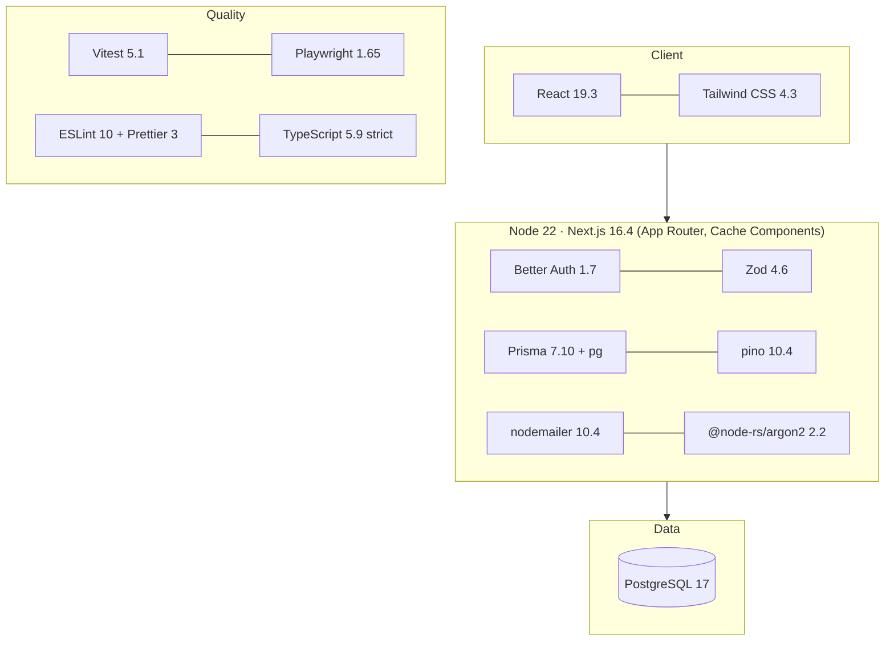

# Technology Stack

| Field | Value |
|---|---|
| Version | 1.0 |
| Last updated | 2026-11-12 |
| Exact versions | `package.json` / `package-lock.json` (this table is updated with each upgrade) |

| Layer | Technology | Version | Why |
|---|---|---|---|
| Runtime | Node.js | 22 | LTS; matches `@types/node` 22 |
| Framework | Next.js | 16.4.6 | UI + API in one app (ADR-001); server rendering |
| UI | React | 19.3 | Server + client components |
| Styling | Tailwind CSS | 4.3.5 | Utility CSS, no runtime cost |
| Language | TypeScript | 5.9.3 | Strict; TS 7 blocked by typescript-eslint (D-14) |
| Validation | Zod | 4.6.7 | One schema for client and server; `when` for cross-field rules |
| Database | PostgreSQL | 17 | Relational, full-text search, triggers (ADR-002/003) |
| ORM | Prisma + adapter-pg | 7.10.1 | Typed queries; stable over 8.0 RC (D-08) |
| Auth | Better Auth | 1.7.18 | ADR-004 |
| Hashing | @node-rs/argon2 | 2.2.2 | Argon2id, OWASP params |
| Logging | pino | 10.4.0 | JSON logs, redaction |
| Email | nodemailer | 10.4.0 | SMTP to Mailpit / provider |
| Unit / integration | Vitest | 5.1 | Fast; real-DB integration tests |
| E2E | Playwright | 1.65.0 | Real browser, screenshots, traces |
| Lint / format | ESLint 10, Prettier 3.10 | – | Zero-warning policy |
| Local services | Docker Compose: postgres:17-alpine, axllent/mailpit:v1.32.0 | – | Same majors as CI |
| CI | GitHub Actions | SHA-pinned | [09-deployment/02-ci-cd-pipeline.md](../09-deployment/02-ci-cd-pipeline.md) |

## Upgrade policy
- New dependencies pinned to releases **≥ 2 weeks old** (D-09).
- Dependabot weekly; merge only when the PR's CI is green; majors of `typescript` and `@types/node` ignored
  until compatible (R-14).
- After a Playwright bump: `npx playwright install chromium`.
