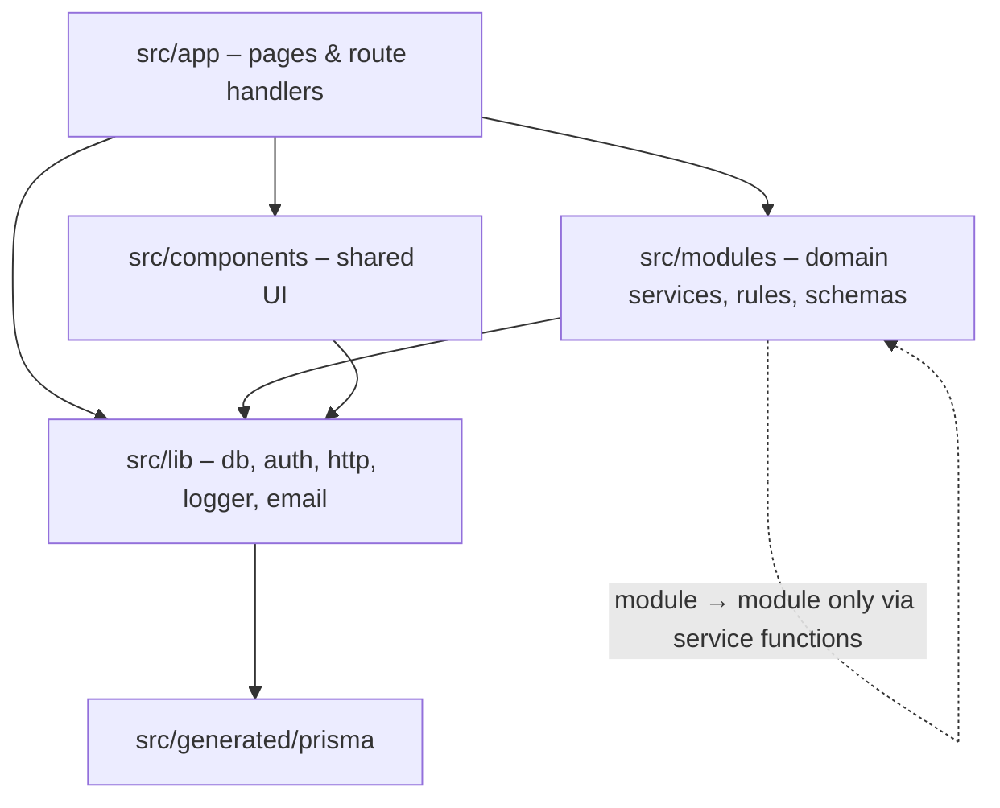

# Codebase Structure

| Field | Value |
|---|---|
| Version | 1.0 |
| Last updated | 2026-11-12 |

## 1. Repository layout

```
jobconnect/
├── src/
│   ├── proxy.ts                 runs before every request (id, CSRF, CSP, role gate, job 404)
│   ├── app/                     routes only – no business logic
│   │   ├── (auth)/              register, login, check-email, forgot/reset-password
│   │   ├── employer/            dashboard, company, jobs (list/new/[id]/edit)
│   │   ├── admin/               dashboard, companies, jobs
│   │   ├── jobs/                public search + details
│   │   ├── privacy/             placeholder policy
│   │   └── api/
│   │       ├── auth/[...all]/   Better Auth
│   │       ├── health/          DB ping
│   │       └── v1/              JSON API (industries, jobs, employer/*, admin/*)
│   ├── modules/                 business logic, one folder per domain
│   │   ├── auth/                sign-up rules, password, emails, messages, session, policy, safe-next, forms
│   │   ├── audit/               recordAudit
│   │   ├── company/             schemas, rules, service, emails, labels, components
│   │   └── job/                 schemas, rules, service, search, search-params, emails, labels, components
│   ├── lib/                     framework-level helpers
│   │   ├── auth.ts, auth-client.ts, db.ts, env.ts, email.ts, logger.ts, privacy.ts, uuidv7.ts
│   │   ├── http/                api wrappers, problem responses, errors, request id, page helper
│   │   ├── security/            CSP, CSRF
│   │   └── client/              browser fetch helper
│   ├── components/              shared UI (ui/*, action-panel, auth-card, site-header)
│   └── generated/prisma/        generated client (git-ignored)
├── prisma/                      schema, migrations, seed, demo users
├── e2e/                         Playwright specs + helpers
├── scripts/                     perf-search.ts
├── docs/                        this documentation
└── .github/                     CI workflow, Dependabot, PR template
```

## 2. Layers and allowed dependencies



| Layer | May import | Must not |
|---|---|---|
| `app/` | modules, lib, components | contain business rules or Prisma queries |
| `modules/<x>/service.ts` | lib, other modules' **service** functions | import `app/` or another module's internals |
| `modules/<x>/rules.ts`, `schemas.ts` | nothing server-only (shared with the browser) | touch the database |
| `lib/` | generated client, npm packages | import modules (except `proxy.ts`, which uses `job/search`) |

## 3. Inside a module (company / job)

| File | Role | Server-only? |
|---|---|---|
| `schemas.ts` | Zod input schemas + enum label maps | No – used by forms too |
| `rules.ts` | Transition tables, pure rule functions | No – unit tested |
| `service.ts` | Use cases: role + ownership checks, guarded updates, audit, emails | Yes (`server-only`) |
| `labels.ts` | Plain-language status labels, formatting | No |
| `emails.ts` | Email templates (escaped HTML + text) | No |
| `components/` | Forms, panels, previews | Client or server components |
| `*.test.ts` / `*.int.test.ts` | Unit / integration tests | – |
