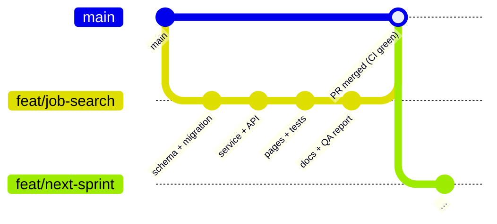
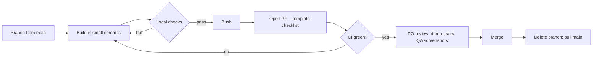

# Development Workflow

| Field | Value |
|---|---|
| Version | 1.0 |
| Last updated | 2026-11-12 |

## 1. First-time setup

```bash
nvm use                      # Node 22
npm install                  # also generates the Prisma client
cp .env.example .env.local   # set BETTER_AUTH_SECRET: openssl rand -base64 32
npm run db:up                # Docker: PostgreSQL 17 + Mailpit
npm run db:deploy            # apply migrations
npm run db:seed              # demo users (see prisma/demo-users.ts)
npx playwright install chromium
npm run dev                  # http://localhost:3000 · inbox http://localhost:8025
```

## 2. Branch → pull request → main





**Never commit to `main`.** Stacked branches are fine when a feature depends on an unmerged one – merge in
order.

## 3. Local checks before every push

```bash
npm run format:check && npm run lint && npm run typecheck && npm test
npm run test:integration     # DB / auth / permissions changed
npm run test:e2e             # a user flow changed (stop `npm run dev` first is not needed – uses port 3100)
npm run perf:search          # search query changed
```

## 4. Gotchas we have hit (and the fix)

| Symptom | Cause | Fix |
|---|---|---|
| Pages 500 locally: missing `@tailwindcss/turbopack/…index.mjs` | `npm ci` ran while `next dev` held files | Stop the dev server, `rm -rf node_modules`, `npm ci` |
| New table "missing" in the running dev server | Prisma client cached on `globalThis` | Restart `npm run dev` after migrations |
| `prisma migrate dev` hangs | It is prompting interactively (drift / new migration) | Check `prisma migrate diff`; run with `< /dev/null` to see the prompt text |
| Tests fail with "Too many attempts" | Rate limiter (by design) | E2E resets counters automatically; for manual tests: `DELETE FROM rate_limit` locally |
| E2E can't launch the browser | Playwright upgraded | `npx playwright install chromium` |
| `git push` to main rejected | Local main behind (merged PRs) | `git switch main && git pull` – never push main |
