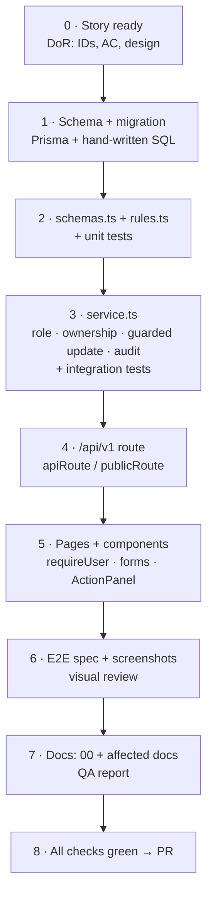

# Adding a Feature – Step by Step

| Field | Value |
|---|---|
| Version | 1.0 |
| Last updated | 2026-11-12 |
| Worked examples | `modules/company` (company verification), `modules/job` (jobs, search) |

| Step | Do | Check |
|---|---|---|
| 1 | Add models/enums to `prisma/schema.prisma`; `npx prisma migrate dev --create-only --name x`; append SQL for CHECKs, triggers, partial indexes; `npm run db:migrate` | `prisma migrate diff … --exit-code` = 0 |
| 2 | Zod input schema (shared by form + API); transition table / pure rules | Unit tests for every rule and edge |
| 3 | Service: `requireRole`, scope by owner, `findFirst({ where: { id, ownerScope } })` → 404; status via `updateMany({ where: { id, status } })` → `stateChanged()`; `recordAudit(tx, …)` in the same `$transaction`; emails via `sendEmailInBackground` | Integration tests: happy path, other user → 404, wrong role → 403, invalid transition → 409, concurrent decisions → one wins |
| 4 | Route under `src/app/api/v1/...`: validate id (`z.uuid()`), `parseBody`, call service, `json()` | `curl` the error codes |
| 5 | Page: `requireUser(roles, returnTo)`, `orNotFound(id, …)`; add to role nav; proxy gate if a new role area | 360 px, keyboard, labels |
| 6 | `e2e/<feature>.spec.ts` with numbered `shot()` steps; seed via `e2e/db.ts` helpers | Run 3× in a row; look at every screenshot |
| 7 | `docs/00` (status, traceability, decisions, change log) + data model / API / UI / tests docs; QA report | Link check |

Reference implementation for a lifecycle with admin decisions: `src/modules/job/` (rules → service → API →
`job-actions.tsx` → `e2e/jobs.spec.ts` → `docs/08-testing/qa-reports/2026-11-12-jobs-qa-report.md`).
