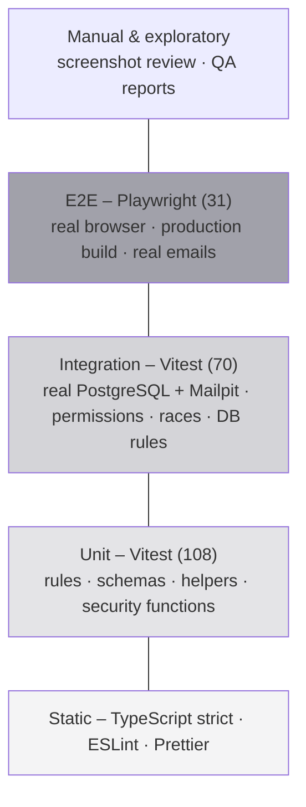

# Test Strategy

| Field | Value |
|---|---|
| Version | 1.0 |
| Last updated | 2026-11-12 |
| Applies to | Every increment (Definition of Done, [07-implementation/01-agile-methodology.md §9](../07-implementation/01-agile-methodology.md#9-definition-of-done)) |

## 1. Test pyramid

(Run counts at 2026-11-12; parameterised cases run once per value.)

## 2. What each layer is for

| Layer | Catches | Doesn't catch | Runs |
|---|---|---|---|
| Static | Type errors, unsafe access, unused code, style | Logic | Editor, CI |
| Unit | Wrong rules (transitions, deadlines, cursors, CSP, redaction, open redirects) | DB/framework behaviour | `npm test`, CI |
| Integration | Permission leaks, constraint/trigger behaviour, concurrent updates, real SQL, email sending | Browser/UI | `npm run test:integration`, CI |
| E2E | Broken journeys, navigation races, status codes, CSP in a real browser, layout at 360 px | Rare data edge cases | `npm run test:e2e` (local; CI planned) |
| Performance | Slow queries at scale | – | `npm run perf:search` |
| Manual | Visual problems, confusing copy | – | Screenshot review per QA report |

**Principles**
1. **Real dependencies over mocks** where it matters: integration tests run against PostgreSQL and Mailpit,
   because mocks can't see constraint, trigger or SQL bugs.
2. **Every permission rule has a negative test** ("another employer gets 404", "candidate gets 403").
3. **E2E runs against a production build** – the dev server hot-reloads and hides streaming/status-code issues.
4. **A flaky test is a bug** – investigated with traces and repeated runs, never retried until green.
5. **Screenshots are reviewed by a person** – several product bugs were only visible there.

## 3. Test data

| Need | Source |
|---|---|
| Demo users per role | `npm run db:seed` (`prisma/demo-users.ts`) |
| Isolated E2E users/companies/jobs | `e2e/db.ts` helpers (local DB only) |
| Search isolation | A unique made-up word per run in titles |
| Rate limits | Cleared before each E2E test (`resetRateLimits`) |
| 10,000 jobs for performance | `scripts/perf-search.ts`, inside a rolled-back transaction |

## 4. Environments
Local Docker (Postgres 17, Mailpit) and CI services use the **same image versions**. E2E uses its own port
(3100) and `HIBP_ENABLED=false` (no third-party dependency in tests).

## 5. Exit criteria per increment
CI green; whole E2E suite green **three runs in a row**; every new screen screenshot reviewed; QA report
written; no open Critical/Major defects in the feature.
