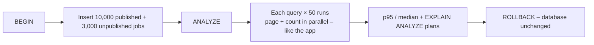
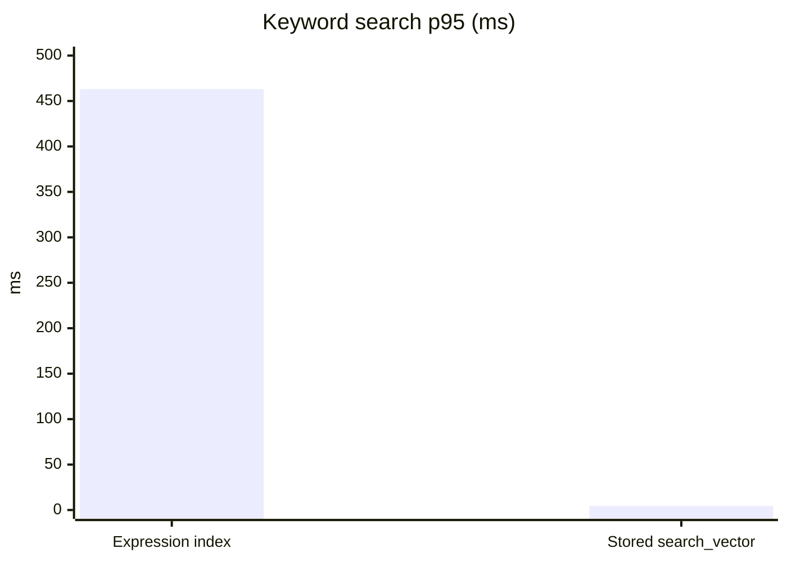

# Performance Testing

| Field | Value |
|---|---|
| Version | 1.0 |
| Last updated | 2026-11-12 |
| Requirement | NFR-PERF-001: job search < 500 ms at p95 with 10,000 published jobs |
| Tool | `scripts/perf-search.ts` – `npm run perf:search` |

## 1. Method

Queries mirror `searchJobs()` exactly (same visibility rule, same filters, same `LIMIT 21` + `count(*)`).
Local Docker PostgreSQL 17 on a MacBook Pro; numbers are indicative, the **plans** are what matter.

## 2. Results (2026-11-12)

| Query | Before (expression index) | After (stored `search_vector`, ADR-010) |
|---|---|---|
| Browse newest | 4.6 ms | 4.2 ms |
| Keyword "engineer" | **463.3 ms** (planner skipped the index; re-computed every row) | **4.5 ms** |
| Keyword + location + work mode | 20.5 ms | 8.8 ms |
| Location only | 19.7 ms | 7.5 ms |

All p95; target 500 ms → **met with > 100× margin**.

## 3. When to re-run
Any change to search SQL, the visibility rule, job indexes, or a PostgreSQL major upgrade. Re-run against
production-sized data before Release 1.0.

## 4. Not yet tested
Concurrent load (500 users, NFR-SCAL-001), page load times (LCP, NFR-PERF-002) – planned for S6 with the
deployed environment.
