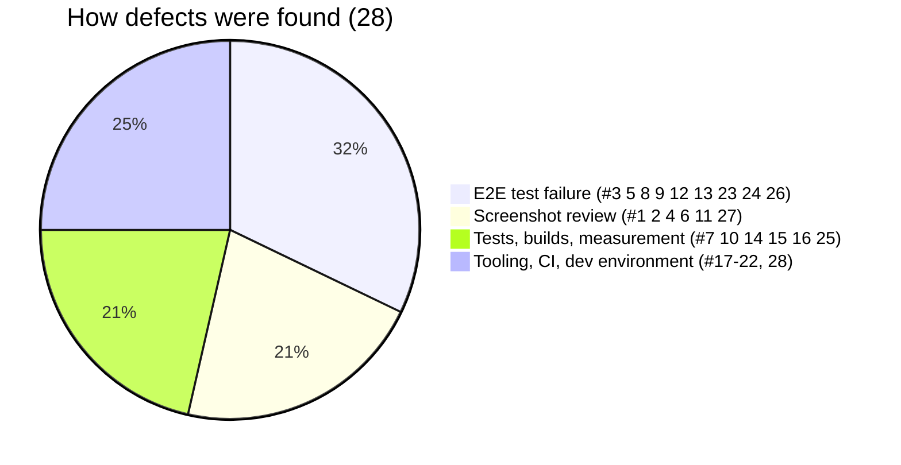

# Defect Log

| Field | Value |
|---|---|
| Version | 1.0 |
| Last updated | 2026-11-12 |

Every defect found so far, how it was found, and how it was fixed. Severity: **Critical** (security/data),
**Major** (feature broken), **Minor** (cosmetic/UX).

| # | Area | Defect | Sev. | Found by | Fix | Status |
|---|---|---|---|---|---|---|
| 1 | Auth emails | Fallback link didn't wrap – email ~2,400 px wide | Minor | Screenshot | Wrapping style + unit test | ✅ |
| 2 | Home | Admins saw the candidate's "search jobs" text | Minor | Screenshot | Per-role text | ✅ |
| 3 | Role pages | Wrong role got **200** (not 404/307) in production builds (streaming) | Major | E2E vs prod build | Proxy role gate (ADR-009) | ✅ |
| 4 | Admin review | Stale validation error after typing a valid reason | Minor | Screenshot | Clear errors on edit | ✅ |
| 5 | Job form | Cross-field errors appeared only after other fields were fixed | Minor | E2E | Zod `when` | ✅ |
| 6 | Job detail | "No actions available" above "Edit job" | Minor | Screenshot | Hide empty panel | ✅ |
| 7 | Search | Keyword p95 **463 ms** (limit 500) | Major | Perf script + EXPLAIN | Stored `search_vector` (ADR-010) | ✅ |
| 8 | Login | "Log in to apply" lost the job (`next` dropped) | Major | E2E | Full page load; login page honours `next` | ✅ |
| 9 | Logout | Push/refresh race left user on the old page | Minor | E2E | Full page load | ✅ |
| 10 | Security | `?next=/\evil.com` accepted as same-site | **Critical** (open redirect) | Writing unit tests | `safeNext` rejects `/\` | ✅ |
| 11 | Header | Links wrapped onto two lines at 360 px | Minor | Screenshot | No-wrap + E2E height check | ✅ |
| 12 | Hidden job pages | 200 with not-found UI (soft 404) | Major (SEO) | E2E | Proxy `isJobVisible` → real 404 | ✅ |
| 13 | Admin decisions | Reply occasionally > 5 s (2 of 5 runs once) | Major | Repeated E2E | Emails after response + timing logs; **not reproduced in 10 runs, root cause unproven** | 🟡 watch |
| 14 | Build | `next build` crashed without secrets (DB client created at import) | Major | Reproduced CI conditions | Lazy `getDb()` | ✅ |
| 15 | Build | Pages read secrets before `headers()` during prerender | Major | Build without env | Read request first | ✅ |
| 16 | Tests | Prisma 7 `migrate dev` doesn't regenerate the client | Major (dev) | Integration failure | `db:migrate` runs `generate` | ✅ |
| 17 | Dev | Stale Prisma client in running dev server after migration | Minor (dev) | 500 on sign-up | Restart dev server (documented) | ✅ |
| 18 | CI | TypeScript 7 (Dependabot) crashed lint on main | Major | CI on main | Reverted to 5.9; Dependabot rule | ✅ |
| 19 | Deps | Lockfile conflict after ESLint 10 bump | Minor | Merge test | Merged main, regenerated lock | ✅ |
| 20 | Local | Interrupted `npm ci` left `node_modules` incomplete (pages 500) | Major (dev) | Dev log | Clean reinstall; stop dev server first | ✅ |
| 21 | Docs | README script rows silently not added (string replace missed) | Minor | Later README check | Table rebuilt; edits now assert | ✅ |
| 22 | Lint | ESLint scanned Playwright's generated report | Minor | Local lint | Ignore test output | ✅ |
| 23 | E2E | Dev server hot-reload reloaded pages mid-test | Major (test) | E2E | Run against production build | ✅ |
| 24 | E2E | Tests hit the login rate limit (works as designed) | Minor (test) | E2E | Reset counters per test | ✅ |
| 25 | Seed | Importing the demo password ran the seed's DB code | Minor (test) | Import error | Split `demo-users.ts` | ✅ |
| 26 | Forms | Empty optional fields (phone; remote job location) became `null` and the API rejected them (forms send the parsed value) | Major | E2E 81 | `nullish` + round-trip unit test for every input schema | ✅ |
| 27 | Navigation | No navigation at all on phones for logged-in users | Major | Screenshot 91 | Candidate tab bar (D-07) + mobile link row | ✅ |
| 28 | Migrations | Docs path rewrite edited comments in 4 applied migrations → Prisma demanded a reset | **Critical** (deploy) | `prisma migrate dev` | Restored (PR); CI rejects changed migrations; `CLAUDE.md` rule | ✅ |

**Open:** #13 (watch in CI). Planned: carry this log forward per sprint.
