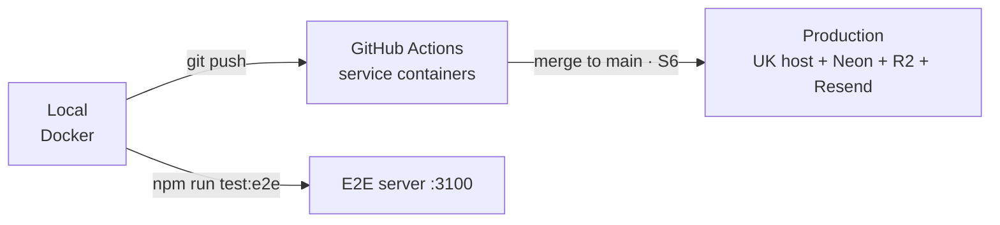

# Environments

| Field | Value |
|---|---|
| Version | 1.0 |
| Last updated | 2026-11-12 |

| Environment | Purpose | Where | Database | Email | Status |
|---|---|---|---|---|---|
| **Local** | Development | `npm run dev` (port 3000) | Docker `postgres:17-alpine` | Mailpit `axllent/mailpit:v1.32.0` (UI :8025) | ✅ |
| **E2E** | Browser tests | `next build && next start -p 3100` (Playwright) | Same local DB | Same Mailpit | ✅ |
| **CI** | Every PR / push to main | GitHub Actions `ubuntu-latest` | Service container Postgres 17 | Service container Mailpit | ✅ |
| **Staging** | – | – | – | – | Not planned for MVP (D-07) |
| **Production** | Real users | Fly.io (London) **or** Render – decision pending (Q1) | Neon (London) | Resend (EU) | ⬜ S6 |

## Configuration per environment

| Variable | Local / E2E | CI | Production | Validated in |
|---|---|---|---|---|
| `DATABASE_URL` | local Docker | service container | Neon (secret) | `src/lib/env.ts` |
| `BETTER_AUTH_SECRET` | random, `.env.local` | fixed CI-only value | host secret store | `env.ts` (≥ 32 chars) |
| `BETTER_AUTH_URL` | `http://localhost:3000` (E2E: `:3100`) | `http://localhost:3000` | `https://<domain>` (Q2) | `env.ts` |
| `SMTP_URL` | `smtp://localhost:1025` | `smtp://localhost:1025` | provider SMTP (secret) | `env.ts` |
| `EMAIL_FROM` | `JobConnect <no-reply@jobconnect.local>` | CI value | `no-reply@<domain>` | `env.ts` |
| `HIBP_ENABLED` | `true` (E2E: `false`) | `false` | `true` | `env.ts` |
| `LOG_LEVEL` | debug (default) | – | info (default) | `logger.ts` |

Secrets never in Git (`.env*` ignored, gitleaks in CI). `.env.example` documents every variable.

