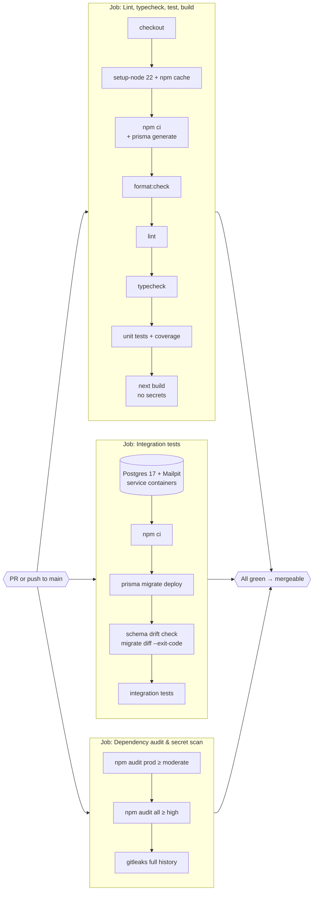
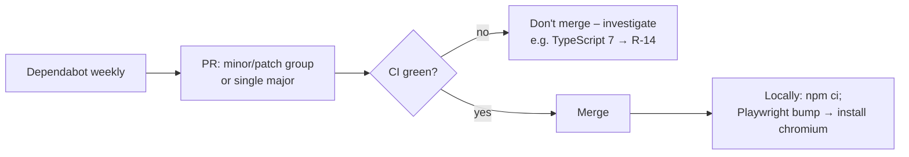
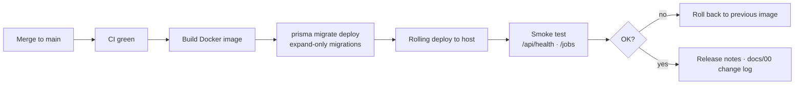

# CI/CD Pipeline

| Field | Value |
|---|---|
| Version | 1.0 |
| Last updated | 2026-11-12 |
| Definition | `.github/workflows/ci.yml`, `.github/dependabot.yml` |

## 1. Continuous integration (as built)

Runs on every pull request and every push to `main`. Actions are pinned to commit SHAs.

| Gate | Fails when |
|---|---|
| format / lint / typecheck | Any style issue, any ESLint warning, any type error |
| unit tests | Any failing test |
| build | The app can't build **without secrets** (catches import-time env access) |
| migrate deploy | A migration doesn't apply to an empty database |
| drift check | Prisma schema and migrated database disagree |
| integration tests | Any DB/permission/email test fails |
| audits | Prod dependency with a moderate+ advisory; any high+; a committed secret |

## 2. Dependency updates

Ignored majors: `typescript` (typescript-eslint support), `@types/node` (must match Node 22).

## 3. Continuous delivery (planned, sprint S6)

Planned additions: E2E job in CI (needs app + Postgres + Mailpit services), branch protection requiring all
jobs (Q5), nightly `pg_dump` backup job (docs/10-operations/03-backup-and-recovery.md).
