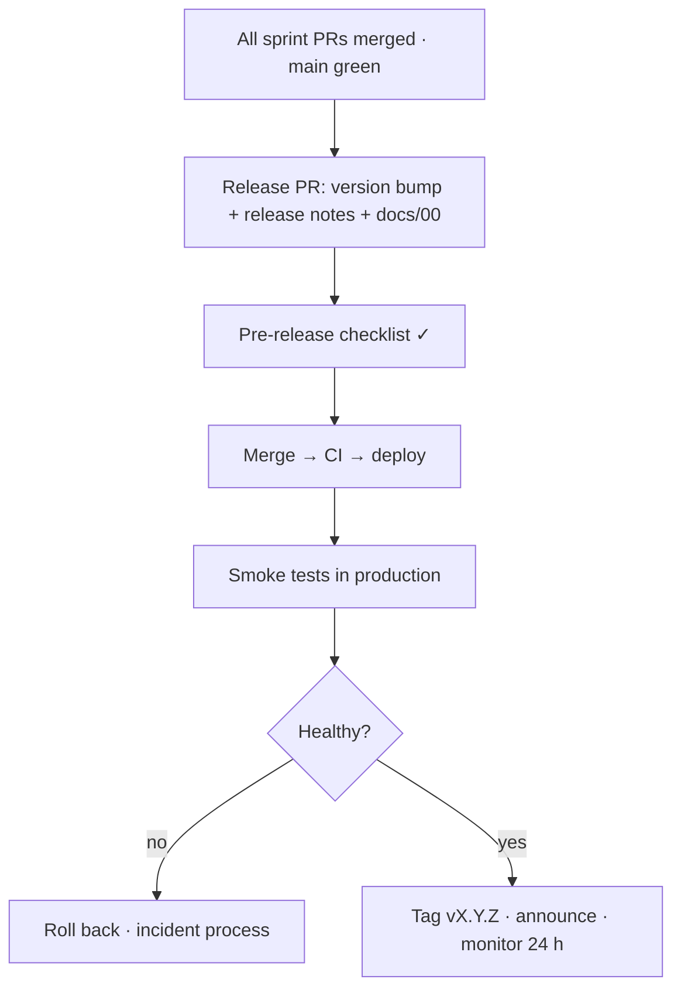

# Release Process

| Field | Value |
|---|---|
| Version | 1.0 |
| Last updated | 2026-11-12 |
| First release | 0.1 (MVP) – after sprint S6 |

## 1. Versioning
Semantic versions for releases: **0.1** MVP → **1.0** full → **1.1+**. `package.json` `version` is bumped in
the release PR. Each merged PR already appears in [00 §13](../00-solution-document.md#13-change-log).

## 2. Release flow



## 3. Pre-release checklist
- [ ] All MVP acceptance tests ✅ ([08-testing/02-test-plan.md §3](../08-testing/02-test-plan.md#3-mvp-acceptance-tests-release-gate))
- [ ] E2E suite green 3× (Chromium, WebKit, Firefox)
- [ ] No open Critical/Major defects
- [ ] Migrations are expand-only (backward compatible with the running version)
- [ ] Backup taken and a restore tested in the last 30 days (NFR-REL-002)
- [ ] Secrets set in the host; `.env.example` up to date
- [ ] Privacy policy text final (placeholder today – 11-content/04)
- [ ] Security audit and accessibility audit items for this release closed (12-audit)
- [ ] Rate limit on the public API in place
- [ ] Release notes written (plain language)

## 4. Release notes template
```
JobConnect vX.Y.Z – <date>
New: …
Improved: …
Fixed: …
Known issues: …
```

## 5. Hotfix
Branch `fix/…` from `main`, minimal change + test, normal PR + CI, deploy, add a defect-log row.
