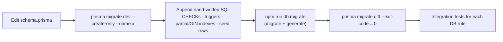
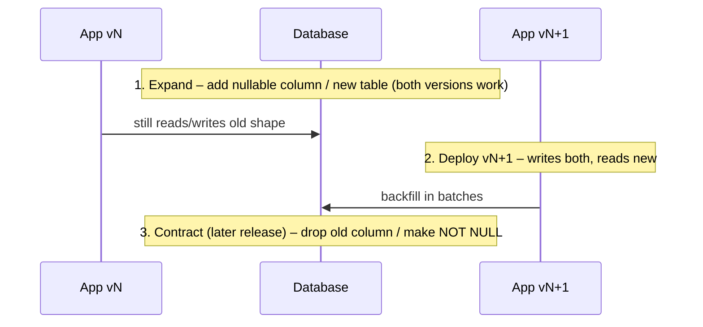

# Database Migrations

| Field | Value |
|---|---|
| Version | 1.0 |
| Last updated | 2026-11-12 |
| Tool | Prisma Migrate 7 (`prisma/migrations/`) |

## 1. Migrations so far

| Migration | Adds |
|---|---|
| `20261111000000_init` | `citext` extension; database timezone UTC |
| `20261112000352_audit_log` | `audit_log`, `user_role`; append-only triggers; 24-month delete rule; action CHECK |
| `20261112001631_auth` | `user`, `session`, `account`, `verification`, `rate_limit`; suspension-reason CHECK |
| `20261112120548_companies` | `industry` (13 seeded), `company`; reason / verified_at / https CHECKs |
| `20261112134056_jobs` | `job` + enums; salary, location, reason, published_at, title, GBP CHECKs; queue + published partial indexes |
| `20261112144445_job_search` | `job_search_document()` function |
| `20261112144742_job_search_vector` | Stored generated `search_vector` + partial GIN index |

## 2. How to write one

Rules
- One migration per change; never edit a migration that is on `main` – add a new one.
- Generated columns: declare as `Unsupported("…")` with `@default(dbgenerated("<exact pg expression>"))`
  so the drift check stays clean (ADR-010).
- Use only syntax supported by the **production** Postgres major (17).
- Every CHECK/trigger gets an integration test that proves the database rejects bad data.

## 3. Zero-downtime changes (expand → migrate → contract)

## 4. Production rules (S6)
`prisma migrate deploy` runs **before** the new image takes traffic; migrations must be backward compatible
with the previous release; a failed migration aborts the deploy (no app change goes live).
