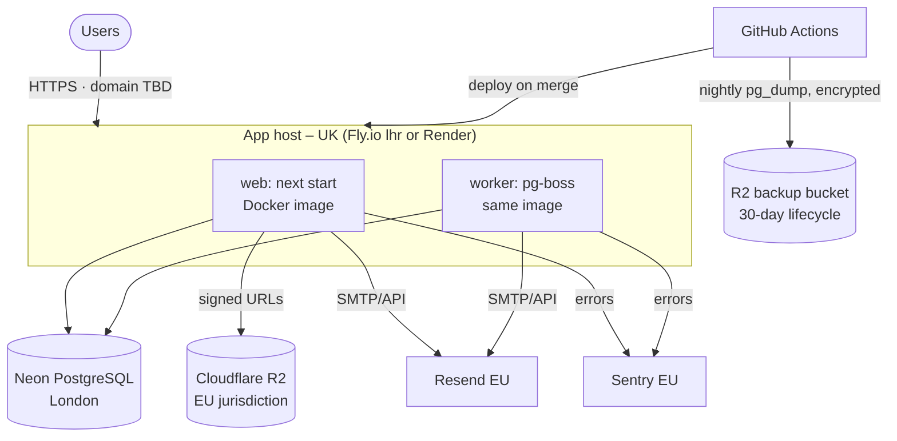

# Deployment Plan (Release 0.1)

| Field | Value |
|---|---|
| Version | 1.0 |
| Last updated | 2026-11-12 |
| Status | **Planned – sprint S6.** Nothing is deployed yet. |
| Decisions pending | Host (Q1), domain (Q2) – [00 §14](../00-solution-document.md#14-open-questions-risks-and-next-steps) |

## 1. Target topology

## 2. Steps

| # | Step | Owner |
|---|---|---|
| 1 | Decide host and domain (Q1, Q2) | PO |
| 2 | Create accounts: host, Neon, Cloudflare (R2 with **EU jurisdiction**), Resend, Sentry (EU region, PII off) | PO |
| 3 | Dockerfile (Next.js standalone output, non-root user) + worker entrypoint | Dev |
| 4 | Secrets in the host (never in Git) – see [01-environments.md](01-environments.md) | PO + Dev |
| 5 | DNS: app record, SPF/DKIM/DMARC for email (R-09) | PO |
| 6 | Deploy workflow: build → `migrate deploy` → rolling deploy → smoke test | Dev |
| 7 | Seed industries (migration) + create the first admin with a **production** admin script (FR-ADM-001; the demo seed refuses non-local DBs) | Dev |
| 8 | Backups: nightly `pg_dump` → encrypted → R2; **restore drill** (MVP criterion) | Dev |
| 9 | Monitoring: Sentry, uptime check on `/api/health` | Dev |
| 10 | Production smoke + E2E against the live URL; release notes | Dev + PO |

## 3. Rollback
Previous Docker image stays available; deploy it again. Database: migrations are expand-only, so the
previous app version still works; data restore from the latest backup only for data loss
([10-operations/03-backup-and-recovery.md](../10-operations/03-backup-and-recovery.md)).

## 4. Estimated cost
≈ £3–6/month on Fly.io or £0 on Render free tier (with limits); Neon, R2, Resend, Sentry free tiers
(docs/06-architecture/01-system-architecture.md §4 – prices to be re-checked at sign-up).
