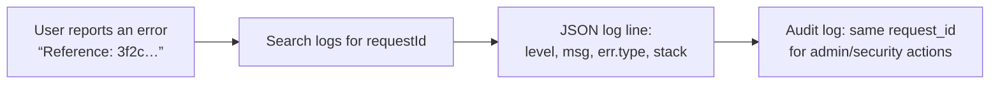

# Runbook

| Field | Value |
|---|---|
| Version | 1.0 |
| Last updated | 2026-11-12 |
| Scope | Local today; production sections apply from Release 0.1 |

## 1. Is it up?

| Check | How | Healthy |
|---|---|---|
| App + database | `curl -i https://<host>/api/health` | `200 {"status":"ok"}` (`503 {"status":"error"}` = DB unreachable) |
| Pages | open `/jobs` | results or "No jobs are open" |
| Email (local) | http://localhost:8025 | new messages arrive |
| Local services | `docker compose ps` | postgres + mailpit `healthy` |

## 2. Tracing a problem with the request id



Every response carries `x-request-id`; every server log line and audit entry has `requestId`. Error
messages to users include it on 500s ("Reference: …").

```bash
# local: logs are JSON on stdout of `npm run dev` / `next start`
grep '"requestId":"<id>"' <log file>
# audit trail for a record
psql … -c "select occurred_at, action, actor_role, metadata from audit_log where target_id = '<uuid>' order by id"
```

## 3. Common situations

| Symptom | Likely cause | Action |
|---|---|---|
| `/api/health` 503 | DB down / wrong `DATABASE_URL` | Check DB status; error details are in the log line with the request id |
| Users get "Too many attempts" | Rate limit (10/min/IP on auth) | Expected under attack; if legitimate (shared office IP), review limits |
| Sign-up fails with "Something went wrong" | HIBP unreachable (fails closed – Q4) | Check HIBP status; decide per Q4 |
| Emails not arriving | SMTP down; logged as "… email failed" (decisions) | Check provider; decisions are already saved (D-17/D-28) |
| Employer says jobs vanished from search | Company suspended, owner suspended, deadline passed, or job paused | Check `job.status`, `deadline`, `company.verification_status`, owner `user.status` (the `VISIBLE_JOB` rule) |
| "This was updated by someone else" | Two people acted at once (guarded update) | Expected; refresh |
| Local pages 500 after dependency changes | Broken `node_modules` | Stop dev server; reinstall (07-implementation/04 §4) |

## 4. Admin tasks (until admin UIs exist)

| Task | Today | Planned UI |
|---|---|---|
| Create an admin | Local: `npm run db:seed` (demo only). Production: admin script (S6) | – (by design, FR-ADM-001) |
| Suspend a user | Not available yet | `/admin/users` (S5) |
| Suspend / reinstate a company | `/admin/companies` → review → Suspend | ✅ |
| Remove a job | `/admin/jobs` → review → Remove | ✅ |
