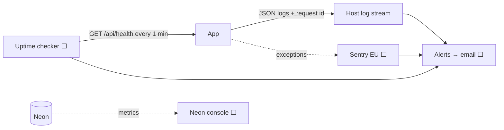

# Monitoring and Alerting

| Field | Value |
|---|---|
| Version | 1.0 |
| Last updated | 2026-11-12 |
| Status | Logging ✅ · error monitoring and alerts ⬜ (sprint S6) |

## 1. Signals

| Signal | Source | Status |
|---|---|---|
| Structured logs (`level`, `time`, `requestId`, `msg`, redacted fields) | pino | ✅ |
| Decision timings ("company/job decision committed", "… email sent/failed", `ms`) | services | ✅ |
| Health | `/api/health` (DB ping, 2 s timeout) | ✅ |
| Error tracking | Sentry (EU, send-PII off) | ⬜ |
| Uptime | external checker on `/api/health` | ⬜ |

## 2. Service level objectives (from NFRs)

| SLO | Target | Measure |
|---|---|---|
| Availability | 99.5 % monthly (NFR-REL-001) | Uptime checker |
| Search latency | p95 < 500 ms (NFR-PERF-001) | Request timing logs |
| Page load | LCP < 2.5 s on 4G (NFR-PERF-002) | Lighthouse / RUM |
| Email delivery | Decision emails sent < 1 min | "email sent" logs |

## 3. Alerts (planned)

| Alert | Condition | Severity |
|---|---|---|
| Site down | `/api/health` fails 3 checks in a row | P1 |
| Error spike | > 10 new Sentry events in 5 min | P2 |
| Email failures | any "email failed" log in 15 min | P3 |
| Backup missing | nightly backup job failed | P2 |
| Cost | host or AI spend over budget (NFR-AI-005) | P3 |
