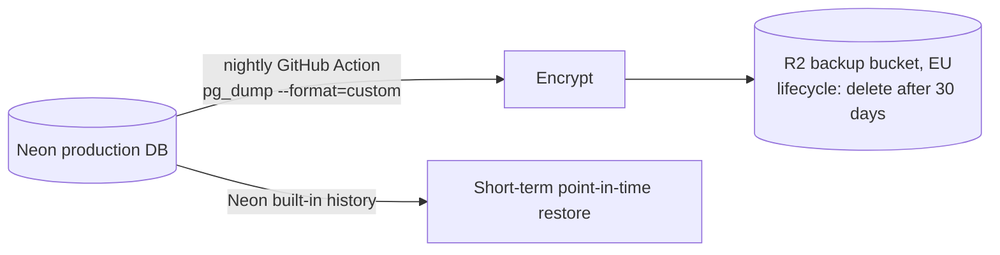
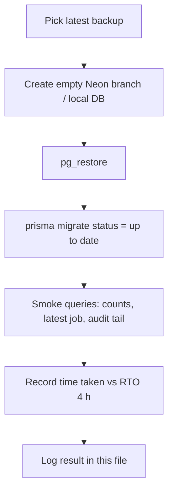

# Backup and Recovery

| Field | Value |
|---|---|
| Version | 1.0 |
| Last updated | 2026-11-12 |
| Requirements | NFR-REL-002 (daily, 30-day retention, restore tested before each release), NFR-REL-003 (RPO 24 h, RTO 4 h), NFR-PRV-003 (backups expire ≤ 35 days) |
| Status | **Planned – sprint S6** |

## 1. Backup design

| Layer | Protects against | Retention |
|---|---|---|
| Neon history / branches | Recent mistakes (minutes–hours) | Plan-dependent |
| Nightly `pg_dump` to R2 | Provider loss, larger mistakes | 30 days (≤ 35 for GDPR) |
| CV objects in R2 (S3+) | – | Lifecycle aligned with erasure rules |

## 2. Restore drill (before every release – MVP criterion)

## 3. Drill log

| Date | Backup | Restored to | Duration | Result |
|---|---|---|---|---|
| – | – | – | – | First drill due before Release 0.1 |

## 4. Recovery scenarios

| Scenario | Action | Data loss |
|---|---|---|
| Bad deploy | Roll back image (09-deployment/05 §3) | none |
| Bad data change | Neon point-in-time restore to a branch; copy fixed rows | minutes |
| Database lost | Restore last nightly dump | ≤ 24 h (RPO) |
| Erasure obligations after restore | Re-run erasure job for accounts deleted since the backup | – |
