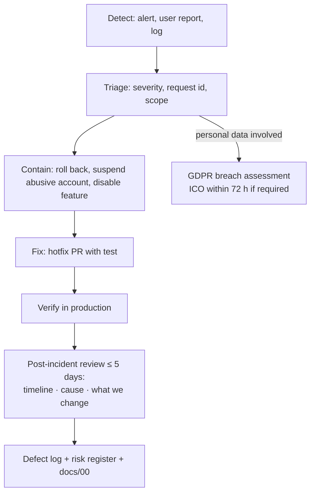

# Incident Response

| Field | Value |
|---|---|
| Version | 1.0 |
| Last updated | 2026-11-12 |

## 1. Severity

| Level | Examples | Response |
|---|---|---|
| **P1** | Site down; data breach; personal data exposed | Immediately |
| **P2** | Core loop broken (can't log in / post / apply); backup failing | Same day |
| **P3** | Single feature degraded; email delays | Next working day |
| **P4** | Cosmetic | Backlog |

## 2. Process

## 3. Personal data breach (UK GDPR Art. 33/34)
1. Contain and preserve evidence (logs, audit entries – audit log can't be altered).
2. Assess: what data, how many people, likely risk.
3. If reportable: notify the ICO **within 72 hours** of becoming aware; inform affected people if high risk.
4. Record every breach (even unreported) in the incident log below.

*This is an operational checklist, not legal advice – confirm obligations with a privacy professional before launch.*

## 4. Incident log

| Date | Severity | Summary | Cause | Actions | Review |
|---|---|---|---|---|---|
| 2026-11-12 | (pre-production) P2-equivalent | CI red on `main` after Dependabot TypeScript 7 | typescript-eslint unsupported | Revert (PR #10), Dependabot ignore rule | R-14 added; branch protection proposed (Q5) |
