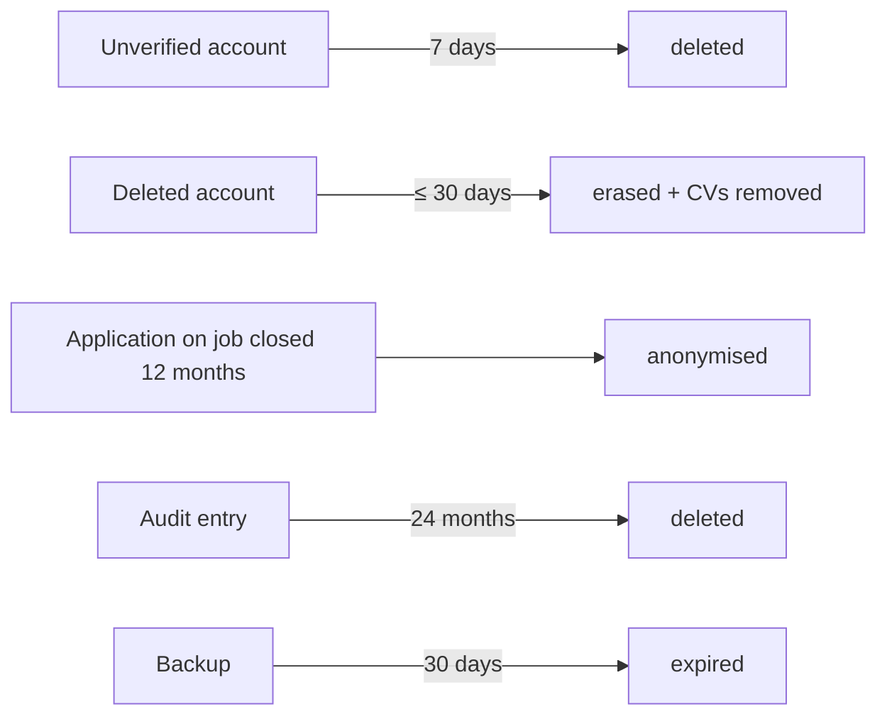

# Maintenance

| Field | Value |
|---|---|
| Version | 1.0 |
| Last updated | 2026-11-12 |

## 1. Routine tasks

| Task | Frequency | How | Status |
|---|---|---|---|
| Dependency updates | Weekly | Dependabot PRs; merge when CI green; `npm ci` locally; Playwright bump → install browser | ✅ |
| Security advisories | Weekly + on alert | `npm audit`; CI gates | ✅ |
| Review rate-limit / error logs | Weekly | Logs, Sentry | ⬜ |
| Restore drill | Before each release | 03-backup-and-recovery.md §2 | ⬜ |
| Risk review | Every retrospective | 02-product-strategy/05-scope-and-risks.md | ✅ |
| Docs check | Every PR | `CLAUDE.md` rule, PR template | ✅ |
| Regenerate test catalogue | When tests change | `npm run docs:test-cases` | ✅ |

## 2. Scheduled data jobs (background worker – planned)

| Job | Schedule | Rule | Status |
|---|---|---|---|
| Delete unverified accounts | Daily | > 7 days (BR-USR-001) | ⬜ |
| Erase deleted accounts + CVs | Daily | ≤ 30 days (NFR-PRV-003) | ⬜ |
| Anonymise old applications | Daily | jobs closed > 12 months (BR-APP-009) | ⬜ |
| Delete old audit entries | Daily | > 24 months (BR-AUD-001; DB trigger already allows only this) | ⬜ |
| Auto-close jobs past deadline | Hourly | BR-JOB-006 (search already hides them) | ⬜ |
| Expired sessions / verification tokens | Daily | housekeeping | ⬜ |

## 3. Data retention summary

