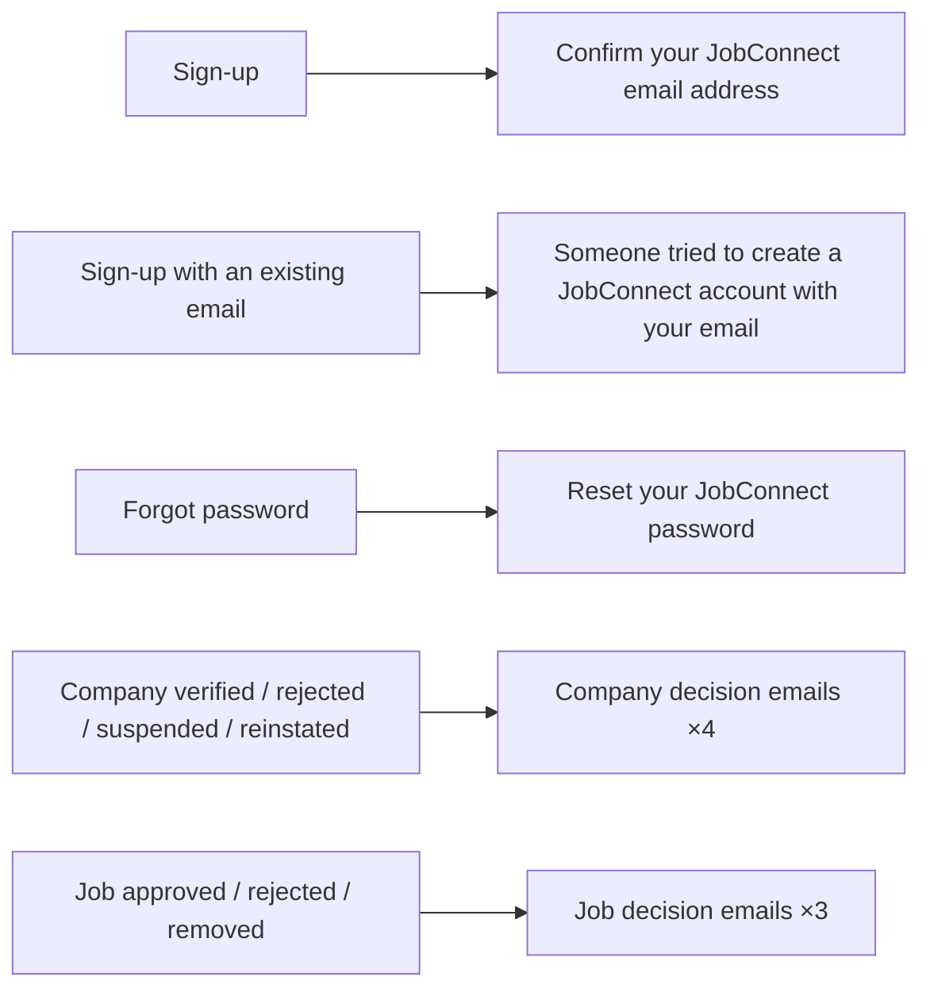

# Email Catalogue

| Field | Value |
|---|---|
| Version | 1.0 |
| Last updated | 2026-11-12 |
| Templates | `src/modules/auth/emails.ts`, `src/modules/company/emails.ts`, `src/modules/job/emails.ts` |

All emails have a **plain-text and an HTML** version; names, reasons and links are HTML-escaped; long links
wrap (defect #1). Sent locally to Mailpit (http://localhost:8025).

| # | Trigger | Recipient | Subject | Content | Link | Timing |
|---|---|---|---|---|---|---|
| 1 | Sign-up | New user | Confirm your JobConnect email address | Greeting, why, expiry 24 h | Verify link | During the request |
| 2 | Sign-up with a registered email | Existing owner | Someone tried to create a JobConnect account with your email | "You already have an account" | `/login` | During the request |
| 3 | Forgot password | Account owner (if exists) | Reset your JobConnect password | Expiry 1 h; ignore if not you | Reset link | During the request |
| 4 | Company verified | Employer | Your company is verified on JobConnect | Can now submit jobs | `/employer` | After the response (D-28) |
| 5 | Company rejected | Employer | Your company profile needs changes | **Reason** | `/employer` | After the response |
| 6 | Company suspended | Employer | Your company has been suspended on JobConnect | **Reason**; jobs hidden | `/employer` | After the response |
| 7 | Company reinstated | Employer | Your company has been reinstated on JobConnect | Jobs visible again | `/employer` | After the response |
| 8 | Job approved | Employer | Your job is live on JobConnect | Live now | `/employer/jobs/{id}` | After the response |
| 9 | Job rejected | Employer | Your job advert needs changes | **Reason** | `/employer/jobs/{id}` | After the response |
| 10 | Job removed | Employer | Your job advert was removed from JobConnect | **Reason** (policy) | `/employer/jobs/{id}` | After the response |
| ⬜ | Application status change (Release 1.0, FR-CAN-016) | Candidate | – | – | – | Worker |
| ⬜ | New applicant (Release 1.0, FR-EMP-022) | Employer | – | – | – | Worker |

**Sender:** `EMAIL_FROM` (`JobConnect <no-reply@…>`). **Production needs** a domain with SPF, DKIM and DMARC
(R-09, Q2). Screenshots: [06](../08-testing/qa-reports/screenshots/06-email-confirmation.png),
[12](../08-testing/qa-reports/screenshots/12-email-reset.png),
[27](../08-testing/qa-reports/screenshots/27-email-company-rejected.png).
