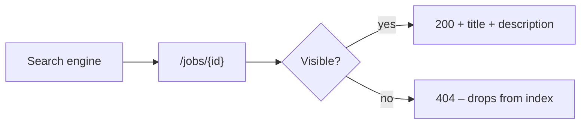

# SEO and Metadata

| Field | Value |
|---|---|
| Version | 1.0 |
| Last updated | 2026-11-12 |

Public job pages are JobConnect's main discovery channel (value proposition §3).

## 1. As built

| Page | `<title>` | Description | Indexable |
|---|---|---|---|
| `/` | JobConnect | "A job marketplace with verified employers and real-time application tracking." | Yes |
| `/jobs` | Find jobs · JobConnect | "Jobs from verified employers, with real application status." | Yes |
| `/jobs/{id}` | `{title} at {company} · JobConnect` | First 160 characters of the job description | Yes – only visible jobs |
| Hidden/unknown job | Next.js not-found | – | **Real HTTP 404** (D-26) – not indexed |
| `/employer/*`, `/admin/*` | Page titles | – | Behind login (307 / 404) |
| Auth pages | e.g. "Log in · JobConnect" | – | Yes (low value) |

## 2. Planned

| Item | Why | When |
|---|---|---|
| `JobPosting` structured data (JSON-LD) on job pages | Eligibility for Google's job search (change request – not yet accepted) | Release 1.0 (PO decision) |
| `robots.txt` + `sitemap.xml` of visible jobs | Discovery; keep private areas out | S6 |
| `noindex` on auth pages | Avoid thin pages in results | S6 |
| Canonical URLs for search pages with filters | Avoid duplicate content | Release 1.0 |
| Open Graph image | Sharing | Release 1.0 (needs brand, Q3) |
