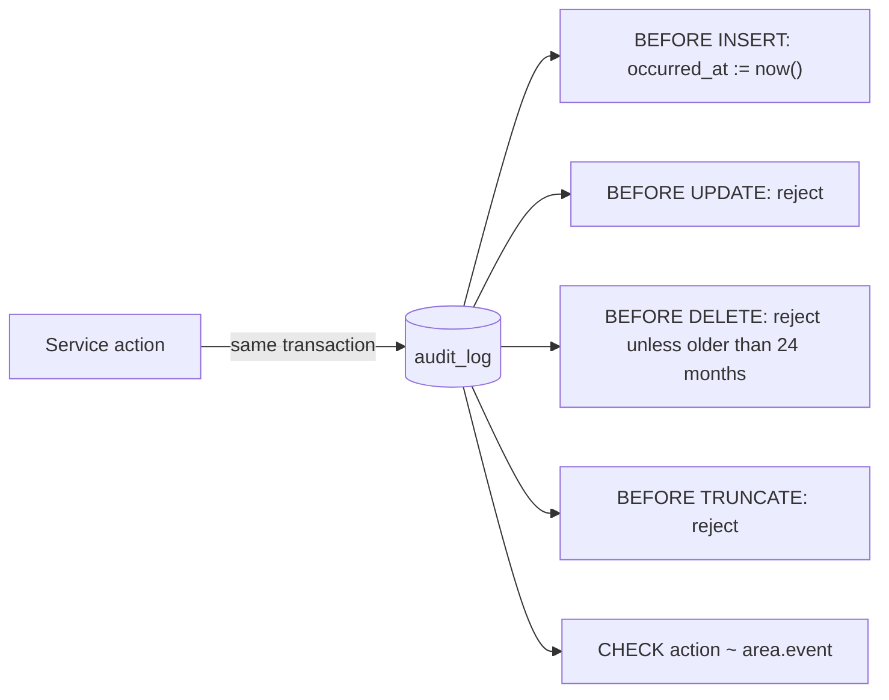

# Audit Logging

| Field | Value |
|---|---|
| Version | 1.0 |
| Last updated | 2026-11-12 |
| Requirements | FR-ADM-019 (record), FR-ADM-021 (immutable), BR-AUD-001 (24-month retention), NFR-PRV-004 |
| Code | `src/modules/audit/audit.ts`, migration `…_audit_log` |

## 1. What is recorded

| Action | When | Actor | Status |
|---|---|---|---|
| `auth.signup` | Account created | the new user | ✅ |
| `auth.login` | Session created (with IP) | user | ✅ |
| `auth.login_failed` | Sign-in failed (no email stored) | – | ✅ |
| `auth.password_reset_requested` | Reset requested | – | ✅ |
| `auth.password_reset` | Password changed via reset | user | ✅ |
| `company.verified` · `.rejected` · `.suspended` · `.reinstated` | Admin decision (+ from/to, reason) | admin | ✅ |
| `job.approved` · `.rejected` · `.removed` | Admin decision (+ from/to, reason) | admin | ✅ |
| `auth.logout`, `auth.password_changed`, `user.*`, `industry.*` | Defined; emitted when those features ship | – | ⬜ |

## 2. How it is protected

| Property | Mechanism | Proven by |
|---|---|---|
| Can't be edited | UPDATE trigger | `audit.int.test.ts` |
| Can't be deleted early | DELETE trigger (only > 24 months) | integration test (incl. retention delete) |
| Can't be wiped | TRUNCATE trigger | integration test |
| Time can't be faked | DB sets `occurred_at` | integration test |
| Decision and entry commit together | `recordAudit(tx, …)` inside `$transaction` | concurrency test: losing decision leaves no entry |
| No personal data in metadata | `assertNoPersonalData` (sensitive key list) | unit test |
| Survives user deletion | No foreign keys | design (ER diagram) |

## 3. Reading it
Admin viewer (FR-ADM-020) is Release 1.0. Until then: `select … from audit_log where target_id = …` (runbook §2).
Each entry has `request_id`, linking it to application logs.
