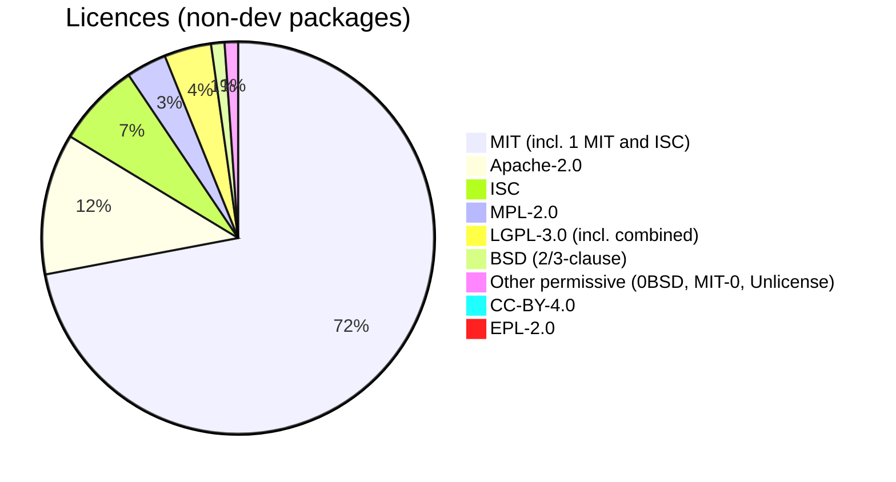

# Dependency and Licence Audit

| Field | Value |
|---|---|
| Version | 1.0 |
| Last updated | 2026-11-12 |
| Method | `npm audit`; licences from `package-lock.json` (non-dev packages) |

## 1. Vulnerabilities (2026-11-12)

| Scope | Critical | High | Moderate | Low | CI gate |
|---|---|---|---|---|---|
| Production dependencies | 0 | 0 | 0 | 0 | fail on ≥ moderate ✅ |
| All (incl. dev tooling) | 0 | 0 | 10 | 0 | fail on ≥ high ✅ |

The 10 moderate advisories are in development tooling (ESLint plugin chain), not shipped to users; reviewed
weekly via Dependabot.

## 2. Licences (packages not marked dev in the lockfile)

| Licence | Packages | Assessment |
|---|---|---|
| MIT, Apache-2.0, ISC, BSD, 0BSD, MIT-0, Unlicense | majority | Permissive ✅ |
| **LGPL-3.0** | `@img/sharp-libvips-*`, `@img/sharp-*` (Next.js image optimisation, dynamically linked native library) | Allowed for unmodified dynamic use; keep notices. JobConnect doesn't use image optimisation yet ✅ |
| **MPL-2.0** | `lightningcss` (CSS build tool) | File-level copyleft; used unmodified at build time ✅ |
| **CC-BY-4.0** | `caniuse-lite` (browser data for build tools) | Attribution; build-time data ✅ |
| **EPL-2.0** | `elkjs` – via Prisma CLI / Prisma Studio | Developer tooling, not shipped ✅ |

No GPL/AGPL packages. Re-run this audit when adding a dependency with native code or an unusual licence.

## 3. Supply-chain controls
Lockfile + `npm ci` in CI · new packages pinned to releases ≥ 2 weeks old (D-09) · Dependabot weekly ·
GitHub Actions pinned to commit SHAs · gitleaks secret scan · `postinstall` limited to `prisma generate`.
