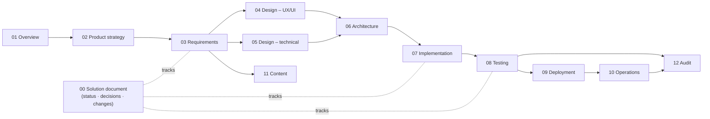

# JobConnect – Documentation

> Start with the **[Software Solution Document](00-solution-document.md)**: live status, what is built,
> every decision and change. This page is the map of everything else.
>
> **Want to see it working?** The **[step-by-step system walkthrough](04-design/07-system-walkthrough.md)** shows
> every flow in 62 real screenshots.
>
> **New to the project?** The **[Project Guide](../PROJECT_GUIDE.md)** explains every folder and file, how a
> request travels through the code, and everything done so far.

Diagrams are written in [Mermaid](https://mermaid.js.org/) and render directly on GitHub.
Anything not built yet is marked **planned**.

| Folder | What it answers | Documents |
|---|---|---|
| [00](00-solution-document.md) | Where are we? What was decided? What changed? | Software Solution Document (living) |
| [01-overview](01-overview/) | What is JobConnect, in one page? | [Project overview](01-overview/01-project-overview.md) · [Glossary](01-overview/02-glossary.md) |
| [02-product-strategy](02-product-strategy/) | Why build it, for whom, and in what order? | [Vision](02-product-strategy/01-vision.md) · [Personas](02-product-strategy/02-personas.md) · [User journeys](02-product-strategy/03-user-journeys.md) · [Value proposition](02-product-strategy/04-value-proposition.md) · [Scope & risks](02-product-strategy/05-scope-and-risks.md) · [MVP](02-product-strategy/06-mvp-definition.md) · [Roadmap & KPIs](02-product-strategy/07-roadmap-and-kpis.md) |
| [03-requirements](03-requirements/) | What must it do? | [Functional](03-requirements/01-functional-requirements.md) · [Non-functional](03-requirements/02-non-functional-requirements.md) · [Business rules](03-requirements/03-business-rules.md) · [Use cases](03-requirements/04-use-cases.md) · [User stories](03-requirements/05-user-stories.md) · [Traceability](03-requirements/06-traceability-matrix.md) |
| [04-design](04-design/) | How does it look and flow? (UX/UI) | [UI flows](04-design/01-ui-flows.md) · [Sitemap & navigation](04-design/02-sitemap-and-navigation.md) · [User-flow diagrams](04-design/03-user-flow-diagrams.md) · [Screen inventory](04-design/04-screen-inventory.md) · [Design system](04-design/05-design-system.md) · [Accessibility](04-design/06-accessibility.md) · [**System walkthrough (screenshots)**](04-design/07-system-walkthrough.md) |
| [05-design](05-design/) | How does it work inside? (technical) | [Data model](05-design/01-data-model.md) · [API](05-design/02-api-design.md) · [State diagrams](05-design/03-state-diagrams.md) · [Sequence diagrams](05-design/04-sequence-diagrams.md) · [ER diagram](05-design/05-er-diagram.md) · [Security design](05-design/06-security-design.md) |
| [06-architecture](06-architecture/) | How is it structured and why? | [System architecture](06-architecture/01-system-architecture.md) · [C4 diagrams](06-architecture/02-c4-diagrams.md) · [ADR log](06-architecture/03-adr-log.md) · [Technology stack](06-architecture/04-technology-stack.md) |
| [07-implementation](07-implementation/) | How do we build it? | [Agile methodology](07-implementation/01-agile-methodology.md) · [Codebase structure](07-implementation/02-codebase-structure.md) · [Coding standards](07-implementation/03-coding-standards.md) · [Development workflow](07-implementation/04-development-workflow.md) · [Adding a feature](07-implementation/05-feature-guide.md) |
| [08-testing](08-testing/) | How do we know it works? | [Test strategy](08-testing/01-test-strategy.md) · [Test plan](08-testing/02-test-plan.md) · [Test cases](08-testing/03-test-cases.md) · [Performance](08-testing/04-performance-testing.md) · [Defect log](08-testing/05-defect-log.md) · [QA reports](08-testing/qa-reports/) |
| [09-deployment](09-deployment/) | How does it reach users? | [Environments](09-deployment/01-environments.md) · [CI/CD pipeline](09-deployment/02-ci-cd-pipeline.md) · [Release process](09-deployment/03-release-process.md) · [Database migrations](09-deployment/04-database-migrations.md) · [Deployment plan](09-deployment/05-deployment-plan.md) |
| [10-operations](10-operations/) | How do we keep it running? | [Runbook](10-operations/01-runbook.md) · [Monitoring](10-operations/02-monitoring-and-alerting.md) · [Backup & recovery](10-operations/03-backup-and-recovery.md) · [Incident response](10-operations/04-incident-response.md) · [Maintenance](10-operations/05-maintenance.md) |
| [11-content](11-content/) | What does it say, and how? | [Content guidelines](11-content/01-content-guidelines.md) · [UX copy & messages](11-content/02-ux-copy-and-messages.md) · [Email catalogue](11-content/03-email-catalogue.md) · [Legal content](11-content/04-legal-and-policy-content.md) · [SEO & metadata](11-content/05-seo-and-metadata.md) |
| [12-audit](12-audit/) | Can we prove it is safe and compliant? | [Audit logging](12-audit/01-audit-logging.md) · [Security audit](12-audit/02-security-audit.md) · [Privacy / GDPR](12-audit/03-privacy-gdpr-audit.md) · [Accessibility](12-audit/04-accessibility-audit.md) · [Dependencies](12-audit/05-dependency-audit.md) |

## Keeping documents current
Every pull request updates `00-solution-document.md` and the document its change belongs to – see the
rule in [`CLAUDE.md`](../CLAUDE.md) and the Definition of Done in
[07-implementation/01-agile-methodology.md §9](07-implementation/01-agile-methodology.md#9-definition-of-done).
